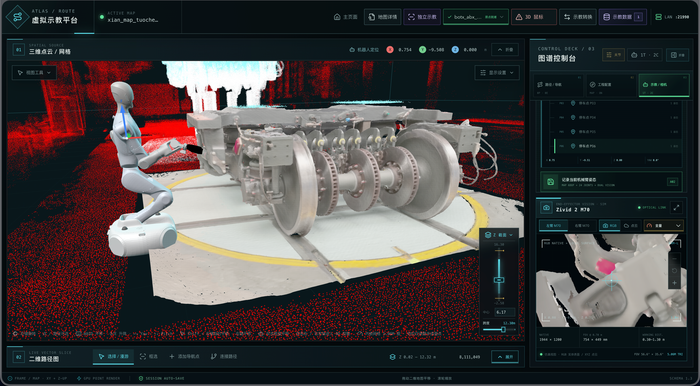
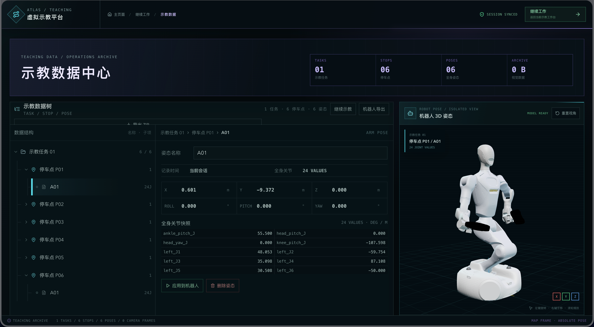
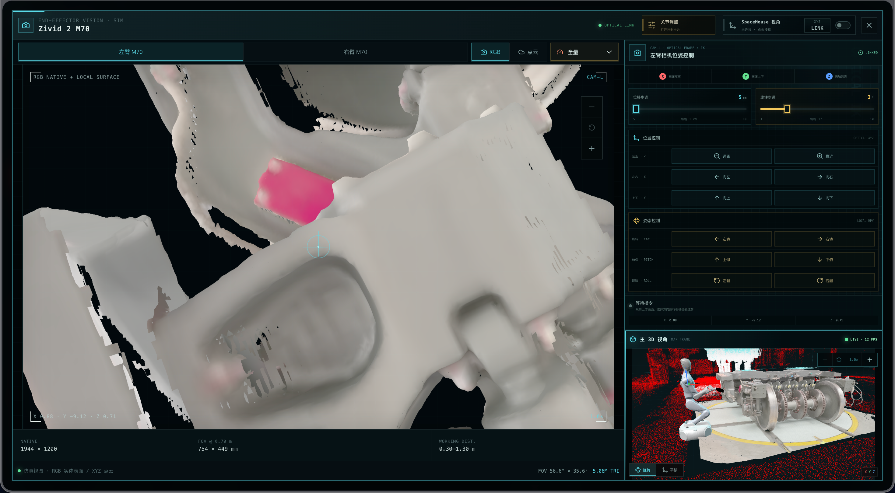
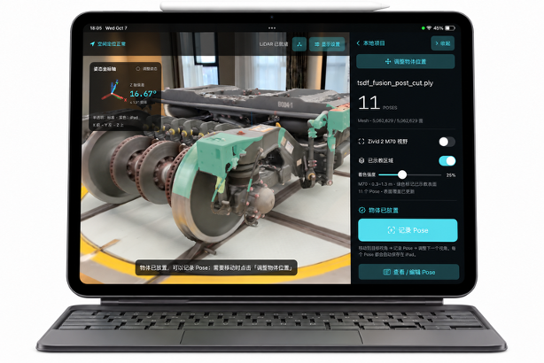
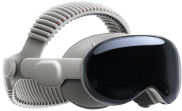

# 🤖 Robot Virtual Teaching

**机器人虚拟示教工程 · 从局部工位示教到完整地图任务编排**

在三维场景中调整机器人位姿、记录停车点与机械臂 Pose、检查视觉参考，并完成任务回放和工程导出。提供 **浏览器工作台**、**iPad AR 应用** 与 **Vision Pro 空间示教应用**。

[GitHub 仓库](https://github.com/GaohaoZhou-ops/robot-virtual-teaching) · [快速启动](#快速启动) · [示教流程](#虚拟示教流程) · [iPad AR 示教](#ipad-pro-ar-逐-pose-示教) · [Vision Pro 空间示教](#vision-pro-空间示教)



*地图示教工作台：在同一场景中调整机器人姿态、组织停车点任务，并检查相机取景。*

<a id="文档导航"></a>

## 📖 阅读导航

| 想做什么 | 从这里开始 |
| --- | --- |
| 了解工程并开始使用 | [核心能力](#核心能力) · [快速启动](#快速启动) · [虚拟示教流程](#虚拟示教流程) |
| 在电脑上操作机器人 | [工作台详细操作](#工作台详细操作) · [相机大图交互](#相机大图交互) |
| 在局部工位与地图之间转换 | [独立示教与地图示教转换](#独立示教与地图示教转换) |
| 使用 Vision Pro 采集空间 Pose | [Vision Pro 空间示教](#vision-pro-空间示教) · [真机接入](vision/README.md#真机接入) |
| 使用 iPad 采集相机 Pose | [iPad Pro AR 逐 Pose 示教](#ipad-pro-ar-逐-pose-示教) |
| 保存工程或对接机器人 | [工作会话自动保护](#工作会话自动保护) · [机器人示教数据导出](#机器人示教数据导出) |
| 使用计算扩展与维护工具 | [停车点集群计算](#停车点集群计算) · [Isaac Sim / PhysX](#可选-isaac-sim--physx-物理后端) · [清理缓存](#清理编译产物与缓存) |
| 查阅验证方法与历史格式 | [验证与回归](#验证与回归) · [历史命名与兼容性](#历史命名与兼容性) |

> 💡 首次使用可先完成“快速启动 → 虚拟示教流程”。各章的折叠区保留操作细节、实现说明和测试记录，按需展开。

<a id="核心能力"></a>

## ✨ 核心能力

| 示教方式 | 场景与坐标系 | 主要用途 |
| --- | --- | --- |
| 地图示教 | 完整 PLY 场景，`map` 坐标系 | 规划机器人停车点、机械臂姿态及导航路径，组织完整场景中的示教任务 |
| 独立示教 | 局部 PLY 物体或工位，`virtual_origin` 坐标系 | 在局部空间完成示教，通过“示教转换”放入地图，或从地图提取区域后精调回写 |
| iPad AR 示教 | 独立示教物体，采集结果使用 `virtual_origin` | 按 1:1 比例放置虚拟物体，逐个记录相机 Pose，通过 AirDrop、Type-C 文件拷贝或局域网同步到电脑 |

| 能力 | 可以完成的工作 |
| --- | --- |
| 🤖 机器人姿态控制 | URDF 加载、底盘与全身关节调整、末端拖拽、相机反算、IK 锁定与姿态库 |
| 📝 示教任务管理 | 按“任务 → 停车点 → 机械臂姿态”组织数据，恢复姿态、回放任务、合并停车点 |
| 📷 视觉示教参考 | Zivid 2 M70 仿真视图、RGB / XYZ 快照与已示教区域显示 |
| 🗺️ 场景与导航 | PLY 点云 / 内嵌网格、Z 轴切片、二维导航点与有向路径编辑 |
| 🧰 模型编辑 | 调整 XYZ / RPY 坐标原点、裁剪 PLY 点云与网格、降采样或简化并导出 |
| 💾 工程保存与交换 | 独立工作区自动保存，完整工程目录、JSON / ZIP 导入导出与机器人数据导出 |

> **能力边界**：iPad 记录相机参考位姿，当前不自动求解机器人关节值；Zivid 画面与覆盖显示来自虚拟模型。机器人执行范围见[导出说明](#机器人示教数据导出)。

<a id="快速启动"></a>

## 🚀 快速启动

### 环境与资源

| 项目 | 要求 |
| --- | --- |
| Web 服务 | Node.js、npm；服务脚本使用 Bash |
| 浏览器 | 支持 WebGL；目录写入与 SpaceMouse 的浏览器条件见对应章节 |
| 克隆仓库 | 安装 Git，以下 SSH 地址需要已配置 GitHub SSH 认证 |
| 机器人模型 | 自行放入根目录 `robots/`，包括模型及网格资源；该目录不随 Git 分发 |
| 机械臂控制 | 需要包含关节定义的 URDF 模型，才能使用关节控制与 IK 示教 |

### 安装与访问

```bash
git clone git@github.com:GaohaoZhou-ops/robot-virtual-teaching.git
cd robot-virtual-teaching
npm install
./scripts/start.sh
```

已有检出可在现有项目目录执行 `npm install` 与启动脚本，本地文件夹名称可以保留。

| 访问位置 | 地址 |
| --- | --- |
| 本机 | `http://127.0.0.1:21990` |
| 同一局域网内的设备 | `http://<运行服务机器的局域网IP>:21990` |

启动和状态脚本会列出检测到的可访问地址。默认监听所有网卡；请使用可信网络，并允许 Node.js 接收入站连接。

### 本地编译

三个入口均按脚本自身位置定位工程，可从其他工作目录调用；构建结束会打印产物与日志的绝对路径。

| 目标 | 命令 | 默认产物 |
| --- | --- | --- |
| 电脑端 Web | `./scripts/build_local.sh` | `dist/` |
| Vision Pro | `./scripts/build_vision.sh` | `vision/build/device/Build/Products/Release-xros/AtlasVisionTeaching.app` |
| iPad Pro | `./scripts/build_ipad.sh` | `ipad/build/device/Build/Products/Release-iphoneos/AtlasTeaching.app` |

电脑端需要 Node.js 和 npm；缺少 Vite 依赖时自动执行 `npm ci`，也可用 `--install` 强制按锁文件重装。日志位于 `build/local/build.log`，运行 `npm run preview` 可访问构建后的电脑端（默认端口 21990，需与开发服务错开使用）。

原生端需要 macOS、完整 Xcode 和对应 SDK，默认构建 **Release、真机架构、未签名** 的 `.app`，不连接或安装到设备。安装真机时在 Xcode 中选择开发团队并签名。两个脚本均支持：

```bash
./scripts/build_vision.sh --simulator --configuration Debug
./scripts/build_ipad.sh --simulator --configuration Debug
```

模拟器产物位于各自的 `build/simulator/Build/Products/Debug-xrsimulator/` 或 `Debug-iphonesimulator/`，日志位于 `<vision|ipad>/build/<device|simulator>/build.log`。可用 `--help` 查看参数；这些构建目录均在清理脚本范围内。

### 服务管理

| 操作 | 命令 |
| --- | --- |
| 查看状态 | `./scripts/status.sh` |
| 启动 | `./scripts/start.sh` |
| 重启 | `./scripts/restart.sh` |
| 停止 | `./scripts/stop.sh` |
| 使用其他端口 | `./scripts/restart.sh 22000` |

| 配置项 | 用途 |
| --- | --- |
| `MAP_STUDIO_PORT` | 覆盖默认端口，也可使用启动 / 重启脚本的第一个参数 |
| `MAP_STUDIO_HOST` | 覆盖监听地址 |

> **重启行为**：先安全终止已有服务，再以相同端口启动新会话。重启前未完成的工程会保存在自动恢复区。

<a id="虚拟示教流程"></a>

## 🧭 虚拟示教流程

**选择模式 → 载入场景 → 调整机器人 → 记录任务 → 回看与导出**

| 步骤 | 操作 | 结果 |
| --- | --- | --- |
| ① 选择工程 | 选“地图示教”或“独立示教”，新建并载入 PLY，或加载已有工程 | 建立当前工作空间 |
| ② 准备机器人 | 点击“机器人 → 机器人模型”，调整基座、关节与末端位姿 | 确定示教起始姿态 |
| ③ 记录示教 | 在“示教”页中新建任务，按工位记录停车点与机械臂 Pose | 保存关节值与视觉参考快照 |
| ④ 检查任务 | 在“示教数据”中回看姿态、播放任务、按需合并停车点 | 检查示教顺序与结果 |
| ⑤ 保存或交换 | 保存完整工程，或在地图示教中使用“导出示教数据” | 获得工程备份或兼容机器人导入包 |

初次体验地图浏览可使用 [maps/xian_map.ply](maps/xian_map.ply)。局部工位放入地图、区域提取与精调回写使用[示教转换](#独立示教与地图示教转换)。

桌面示教数据按以下层级组织：

```text
示教任务
├── 停车点 P01
│   ├── 机械臂姿态 A01 · 基座位姿 / 关节值 / 视觉快照
│   └── 机械臂姿态 A02
└── 停车点 P02
    └── 机械臂姿态 A01
```

使用 iPad 时，打开独立示教工作台的 **设备 → iPad → 同步与接收 → 扫码配对** 弹窗，电脑会自动准备物体并显示二维码与配对码，再进入[AR 采集流程](#ipad-pro-ar-逐-pose-示教)。

<a id="工作台详细操作"></a>

## 🖥️ 工作台详细操作

### 页面与入口

| 页面 / 区域 | 用途 |
| --- | --- |
| 主页面 `/` | 选择示教模式，新建、加载或继续工程 |
| 模型编辑 `/model-editor` | 坐标原点调整、区域裁剪、点云降采样、网格简化与 PLY 导出 |
| 工作台 `/workbench` | 场景浏览、机器人控制与示教采集 |
| 示教数据 `/teaching-data` | 任务树、Pose 预览、恢复、删除、合并与导出 |
| 路径 / 导航 | 连通性检查、导航点与路径属性 |
| 示教 | 新建任务、记录停车点与姿态 |
| 相机 | 左右相机实时画面、相机反算 |
| 地图与工程配置（顶部“工程”菜单） | 地图文件详情、机器人状态、坐标系、截面和定位摘要 |

地图示教和独立示教分别保留工程与缓存。返回主页面后可继续当前工作现场；更换场景时，通过对应模式的“新建工程”载入 PLY。

### 模型编辑

从欢迎页点击 **模型编辑**，选择 **单模型处理** 或 **双模型处理**。单模型可导入或拖入 PLY 点云 / 网格。尚未导入模型或检测到后台模型数据丢失时，直接显示模型编辑欢迎页，可重新导入模型，不显示“请先导入模型”弹窗。参数会自动更新三维预览。点击“原始模型”可在当前结果上叠加半透明的原始模型作为固定参照，点击“继续编辑”收起虚影；对照不改变视角、编辑参数或导出内容。顶部导航栏的“模型详情”可查看原始文件信息、编辑后的顶点数、三角面数、数据体积与尺寸。

三维画布与地图示教、独立示教共用旋转灵敏度、平移和滚轮缩放算法：默认左键拖动旋转，右键或 **Shift + 左键**拖动平移；顶部工具栏中点大小滑条右侧的 **旋转 / 平移**按钮可切换左键操作。拖动中按下 Shift 也可转为平移，松键后恢复原模式。也可点击俯视 / 正视 / 侧视或“适应模型”。预览顶部提供 **显示质量**（流畅 / 均衡 / 精细 / 全量）和 **点大小**；全量显示全部点与面，切换质量保留当前视角。这些显示设置仅影响预览，导出仍使用右侧编辑参数生成的完整结果。

1. **坐标原点**：可填写新原点在原模型坐标系中的 XYZ（米）及 RPY（度），或点击 **移动模型 / 旋转模型**。此时原点固定在画面中，直接拖动模型或画布即可移动 / 旋转模型；右键或 **Shift + 左键**移动模型，滚轮缩放也保留原点的画面位置。仍可拖动模型中心的箭头、平面手柄或旋转圆环进行单轴调整，顶部工具栏的旋转 / 平移按钮与侧栏同步切换移动 / 旋转工具。模型变化与原点数值双向同步，拖动时即时预览，松开后计算完整的裁剪、降采样结果；**Esc** 返回 **浏览视图**，恢复视角操作；若尚在拖动，则同时取消本次拖动，已完成的调整会保留。切换浏览、移动、旋转模式保留当前视角与缩放，即使原点已在画面外也不会自动重新取景；需要重新定位时，可点击“适应模型”或视角预设。使用 `R = Rz(yaw) · Ry(pitch) · Rx(roll)`，导出坐标为 `R⁻¹(p − origin)`；支持将原点放到模型中心。
2. **裁剪模型**：启用后显示包络模型的六面裁剪框，拖动六个面中心的手柄可独立调整长宽高，也可继续填写 X / Y / Z 上下限。范围使用调整原点后的坐标；右侧 **取内 / 取外** 互斥选择保留内部或外部。调整时只预览，点击 **确定** 才更新实际模型及导出结果；未确认时导出暂不可用。被裁掉的部分以橘黄色半透明虚影保留作对照，与蓝色原始模型虚影区分，虚影不会导出。穿过边界的三角面按所选区域切分，切面不自动封口。关闭裁剪工具会收起裁剪框、放弃未确认的调整，保留已确认的裁剪结果和橘黄色虚影；再次开启可继续编辑已确认的范围。完整拖动与确认操作可分别撤销，拖动中按 Esc 可取消该次调整。
3. **降采样 / 降质量**：点云支持体素降采样或按比例均匀抽稀；网格支持体素顶点合并并重建面索引。体素越大，细节越少，颜色使用合并点的平均值。
4. **导出 PLY**：先打开系统保存对话框，可修改文件名并选择保存目录，默认名称为 `*-edited.ply`；取消选择不会导出。确认后写入完整编辑结果，保留 RGB、可用法线与面索引，显示质量及原始模型虚影不影响导出。浏览器不支持系统保存选择器时，提供重命名下载窗口，保存目录遵循浏览器的下载设置。导出的文件可用于新建地图示教或独立示教工程。

**撤销编辑**：按 **Ctrl + Z**（macOS 也支持 **⌘Z**）撤销上一步模型编辑，可连续回退最近 100 步。一次完整拖动、一次参数输入、裁剪 / 精简设置及重置操作分别作为一步；输入框内也支持参数撤销，按 Enter 或离开输入框结束本次输入。拖动中撤销会先取消当前拖动。浏览视角、工具切换和显示质量不计入编辑历史；返回主页面会保留历史，成功更换模型后清空。

编辑按“坐标变换 → 裁剪 → 精简”执行，不覆盖原始文件或现有示教工程。可重置全部参数；返回主页面会保留本次编辑，刷新或关闭浏览器前请先导出。当前支持 PLY 几何，其他自定义属性及外部纹理不会随编辑结果导出。

#### 双模型处理

点击 **打开双模型处理** 进入 `/model-editor/dual`，在左右两个区域分别加载或拖入模型 **A** 和 **B**（支持点云、三角网格及混合数据，加载顺序不限）。每个模型读取完成后立即显示独立的三维预览，可旋转、平移、缩放，并分别调整显示质量和点大小；另一侧仍可继续加载。两侧均成功读取后才显示 **开始编辑**，点击后进入联合编辑。选中后仍可 **重新加载**，连续选文件以最后一次选择为准；失败时在对应区域提示，保留上次成功的预览，重试成功后才能开始编辑。联合编辑顶部的 **模型加载** 可返回分区预览；取消选文件保留原状态。

A 作为固定基准，B 初始与 A 共用坐标原点；B 的 XYZ / RPY 表示其在 A 坐标系中的位置与姿态，变换为 `pA = Rz(yaw) · Ry(pitch) · Rx(roll) · pB + [x,y,z]`。拖动、旋转、浏览视图、Esc 取消及 Ctrl / Cmd + Z 撤销与单模型页面共用交互。成功重新加载任一模型会清空上次结果和撤销历史，B 姿态归零。

模型 B 的外包络是其本地 XYZ 范围形成的长方体，随 B 平移、旋转。右侧 **替换 / 合并** 互斥选择：

- **替换**：删除 A 中处于 B 包络内的部分，再加入完整 B。穿过包络边界的 A 三角面会切分；保留的 A 原顶点坐标不变，边界插值保留颜色和法线，切面不封口。删除区域在预览中显示为橘黄色虚影。
- **合并**：保留完整 A，再加入调整后的 B，保留各自的点和三角面；不进行重叠去重、表面焊接或网格布尔并集。

姿态和模式调整只更新预览，点击 **确定** 才在后台生成完整结果；继续调整后需再次确认才能导出。顶部 **模型详情** 可查看 A、B 和上次确认结果的数量。联合编辑画布中的 **A 质量 / B 质量** 分别控制两个模型，支持流畅、均衡、精细和全量；沿用加载页的各自设置，往返加载页也会保留。切换质量只更新对应模型的预览，保留当前视角与姿态；A 的橘黄色虚影同步使用 A 的质量档位。显示质量、点大小和包络显示开关只影响预览，导出使用完整数据，坐标基于 A；支持系统保存弹窗和重命名下载兼容路径。单模型编辑顶部也有 **双模型处理** 入口，切换页面分别保留两种编辑状态；刷新后需重新导入。

### 工作台菜单

工作台顶部左侧提供独立的“主页面”按钮，其余操作归入四个下拉菜单，当前示教模式显示在地图文件名上方：

| 菜单 | 操作 |
| --- | --- |
| 工程 | 地图与工程配置、另存为工程、保存工程 |
| 示教 | 切换地图 / 独立示教、示教数据、示教转换 |
| 机器人 | 机器人模型选择与显示控制、新建预设姿态（弹窗内可导入文件）、应用已保存预设 |
| 设备 | 3D 鼠标；独立示教另提供 iPad、Vision Pro 两个入口 |

点击菜单后可用上下方向键选择操作、左右方向键切换分类，按 Esc 或点击外部收起。关闭菜单会保留设备连接与控制状态。

<details>
<summary>工程入口、模式切换与坐标系</summary>

#### 新建、加载与恢复

- 打开根地址 `/` 后会先进入主页面，并按“选择示教模式 → 选择工程入口”完成启动：先选“地图示教”或“独立示教”，再点击“新建工程”选择 PLY，或点击“加载工程”进入恢复窗口。
- 恢复窗口会优先列出该模式上次绑定的自动保存目录，其次提供本地自动保存工作区或服务重启保护副本；也可以改选其他完整工程目录，或通过“加载工程引导文件”导入兼容 JSON / 完整 ZIP 工程包。
- 模式选择同时约束新建与加载：地图示教、独立示教分别记住默认工程目录和目录选择器位置，并只展示对应类型的缓存与恢复副本。
- 加载目录、JSON 或 ZIP 前会校验工程类型；选错类型时会提示切换主页面入口，保留现有工作现场。
- 旧工程会依据已有的模式/坐标系字段识别类型，完全没有类型信息时按地图示教处理。
- 实际编辑工作台位于 `/workbench`，示教数据管理位于 `/teaching-data`。
- 两个页面都提供“主页面”和“继续工作”入口；返回主页面只暂停当前页面交互，不会清空点云缓存、机器人姿态、导航图、示教任务或 2D/3D 视角，随后可从主页面的当前工作现场卡片原样继续。

#### 独立空间与模式切换

- “独立示教”是与完整地图模式并列的局部示教入口：选择任意 PLY 点云后，页面不改写、不平移源坐标，直接以文件坐标 `(0, 0, 0)` 建立 `virtual_origin` 虚拟空间；3D 参考平面、ROS 原点轴、机器人初始位姿、停车点和机械臂示教姿态都使用该坐标系。
- 紫色“独立空间”状态、3D/2D 面板标题与底部 frame 标识会明确提示当前模式。
- 独立空间模式会和点云解析缓存、2D/3D 视角及工程文件一起保存，刷新或跨设备打开工程后仍可恢复。
- 工作台顶栏的“示教”菜单提供另一种模式的切换入口；点击后直接切换到对应模式已打开的工程。
- 若目标模式尚无工程，会自动返回主页面并选中该模式，便于新建或加载工程。
- 需要更换地图时，请返回欢迎页，选择“地图示教”并点击“新建工程”。

</details>

### 视角与键盘速查

| 输入 | 相机控制模式 | 机器人控制模式 |
| --- | --- | --- |
| `W / S` | 沿世界 XY 平面前后移动 | 底盘沿本体前向前进 / 后退 |
| `A / D` | 沿世界 XY 平面左右移动 | 麦轮底盘左 / 右横移 |
| `Q / E` | 相机沿世界 Z 轴升降 | 仍控制相机升降 |
| `← / →` | 围绕观察中心调整 yaw | 底盘原地旋转 |
| `↑ / ↓` | 调整相机 pitch | 微调机器人 Z 高度；锁定高度后停止响应 |
| `Shift` + 移动 / 旋转按键 | 加速 | 加速 |
| `Shift` + 左键拖拽 | 临时平移视角 | 优先平移视角，不拖动机器人 |
| 右键拖拽 / 滚轮 | 平移 / 缩放视角 | 平移 / 缩放视角 |

点击 3D 工具栏的 **机器人** 切换底盘控制；**锁定高度** 可固定当前 Z 高度。输入框内编辑不会触发场景键盘控制。

**拖拽撤销**：`Ctrl+Z`（macOS 也支持 `⌘Z`）恢复最近一次末端或底盘拖拽，最多保留 50 次记录；输入框内仍执行文本撤销。

<details>
<summary>场景交互、视角精度与坐标轴</summary>

#### 视角操作与点位显示

- 在欢迎页选择“地图示教”，点击“新建工程”后选择本地 PLY 文件（也可选择仓库中的 `maps/xian_map.ply`）。
- 更换地图时同样通过欢迎页重新创建工程。
- 3D 视图采用自由轨迹球控制，可跨越上下极点持续旋转；左上角只保留一个“旋转”状态按钮，不再提供独立的“平移”按钮。
- 按住 `Shift` 时，该按钮会即时切换为琥珀色的“Shift 平移”，图标、文字和底色同步变化，此时用左键拖拽即可临时平移；也可以在已经按住左键时再按 `Shift` 立即切换。
- 该规则在机器人底盘控制、底盘平面拖拽和机械臂末端控制中同样生效，并优先于机器人对象拖拽。
- 松开 `Shift` 后按钮和鼠标操作都会自动恢复旋转。
- 拖拽过程中一旦鼠标越出 3D 画布，当前手势会立即取消，返回画布后需重新按下才会继续操作。
- 机器人控制关闭时，键盘相机控制默认始终可用：点按或长按 `W/S` 前后移动、`A/D` 左右移动，运动始终限制在世界 XY 平面；`Q/E` 让相机与观察中心沿世界 Z 轴同步上升/下降，方向键 `←/→` 围绕观察中心执行 yaw，`↑/↓` 执行 pitch，所有操作均保持观察距离不变。
- 点击 3D 窗口“机器人”后，`W/S/A/D` 改为麦轮底盘平面移动，`←/→` 控制底盘 yaw，`↑/↓` 以低速微调机器人 Z 高度，用于修正底盘与地面的初始贴合。
- `I/J/K/L` 不再占用，可用于浏览器或其他页面快捷操作。
- 所有键盘移动与旋转按住 `Shift` 均可加速。
- 编辑输入框时不会触发地图移动或旋转；在 3D 画布上滚轮缩放或按下鼠标会自动取回键盘焦点。
- 右键拖拽可随时平移；一旦进入光学放大，或世界位移接近 GPU 浮点精度下限，`W/A/S/D/Q/E` 会统一切换为恒定屏幕速度的像素精密平移，避免按键停顿或需要长按数秒。
- “路径点”按钮可单独显示或隐藏 3D 导航点小球而不影响路径连线；小球几何体积为原设计的 14%，总览距离过远时会使用最小 8 px 的显示 LOD，避免埋没在密集点云中。
- 滚轮采用“物理推近 + 光学细节缩放”的连续模型，在相机接近观察中心前自动切换为光学放大，避免最小距离和大坐标精度造成的缩放停止；近距离时也会同步调整裁剪面和点的屏幕尺寸。
- 使用“点云密度”下拉框可在自动、5%–100% 手动档之间切换 3D 显示采样；颜色按钮默认显示高程色，之后按“原始色 → 纯白色 → 高程色”循环切换，3D 点云与 2D 矢量截面会同步着色；高程色模式会显示以米为单位的比例尺。

#### 高度锁定与地图及工程配置

- 使用 `↑/↓` 完成机器人 Z 高度微调后，可点击 3D 工具栏中机器人按钮旁的“锁定高度”；锁定后这两个高度键会被拦截，按钮、机器人状态条与“地图与工程配置”窗口都会显示 `Z HOLD / 高度已锁`。
- 再次点击即可解锁，锁定状态会随工作会话与工程文件保存。

- 顶部“工程 → 地图与工程配置”：弹窗汇总示教环境、网格质量、机器人模型与当前位姿、麦轮控制、末端相机、坐标系及 Z 截面上下限，并显示当前 PLY 的文件大小、修改/载入时间、来源、MIME、SHA-256、点/面数量，以及 X/Y/Z 各轴的最小值、最大值、跨度和中心。
- 上述文件元数据会随解析后的地图缓存保存，刷新恢复工作现场后仍可查看。

#### 坐标轴与面板折叠

- 3D 标题栏右侧依次为距离状态块、“显示设置”“Z 截面”“折叠”。点击距离状态块可设置距离警告；“显示设置”可调整点云颜色、显示密度与网格质量。
- 3D 和 2D 视图均以 ROS/RViz 风格显示世界坐标原点：X 为红色、Y 为绿色、Z 为蓝色，使用轴杆与箭头表达正方向。
- 3D 坐标轴会根据当前光学缩放自动调整世界尺寸，将屏幕长度控制在约 68 px，避免近距离观察时遮挡点云细节。
- 2D 原点不在当前视野时会停靠在视图边缘，点击原点标记可快速定位到 `(0, 0)`。

- 3D 与 2D 面板标题栏右侧分别提供“折叠 / 展开”按钮。
- 折叠任一面板后，另一面板会自动占满地图工作区；系统最多只折叠一个面板，因此切换折叠目标时不会出现两个地图同时隐藏的情况。
- 折叠状态会随当前工作会话自动保存并在刷新后恢复。

#### 右侧控制台

- 右侧图谱控制台采用三个独立子页：“路径 / 导航”集中显示连通性检测、导航点搜索、路径与点位列表及属性配置；“示教”显示任务新建/打开、停车点新增/选择和当前机械臂姿态记录；“相机”显示实时画面和自动启用的相机反算。控制台默认打开“示教”页，原工程配置统一移至顶部“地图与工程配置”。切换子页不会清空任务与停车点，相机页未打开时仍可随姿态记录双目快照。
- 地图示教的图谱控制台标题栏提供 **导入路径** 按钮，点击后切到“路径 / 导航”页并选择机器人路网 JSON（如 `1014平地路网终版.json`）。导入保留节点、边的 ID、场景名称和有向连接，坐标使用米、Yaw 从弧度转换为界面角度；已有路径和示教任务保留，相同路网重复导入不会新增副本，冲突或无效文件会提示错误。导入结果随工程保存，顶部“示教 → 导入机器人路径”入口也可使用。
- “示教”页直接展示“任务与停车点”，标题旁保留“新建示教任务”和“新增停车点”；任务树填满可用高度，长列表独立滚动，当前停车点位姿与姿态记录按钮保留在底部。
- 控制台标题栏提供向右折叠按钮；收起后只保留窄幅恢复轨道，释放的宽度会由地图工作区自动占用，折叠状态也会随工作会话在刷新后恢复。

- 通过顶栏“示教数据”进入管理页；返回主工作台后仍会保留当前任务与停车点上下文。
- 全关节控制及姿态库保留在独立浮窗中，点击 2D 或 3D 中的导航点、路径时，控制台会自动切回“路径 / 导航”并打开对应属性。

</details>

### 机器人与机械臂控制

| 操作 | 使用方式 |
| --- | --- |
| 加载模型 | 顶部“机器人 → 机器人模型”，选择 `robots/` 中的 URDF、GLB、GLTF 或 STL |
| 底盘控制快捷操作 | 双击 3D 窗口中的机器人底盘，启用与“机器人”按钮相同的 WASD 控制 |
| 平面拖动底盘 | 点击“视图工具 → 机器人控制 → 拖动底盘”，再按住底盘拖拽；保持 Z 与 RPY |
| 控制末端 | 双击腕部或末端 Zivid，使用六自由度空间球或输入 XYZ / RPY |
| 躯干联动 | 双击胸甲，拖动操作轴或用滑杆、数值调整高度 / yaw / pitch |
| 本体锁定 | 冻结本体坐标系下的关节姿态，末端随机器人移动 |
| 全局锁定 | 保持地图中的末端位姿，底盘移动时持续进行 IK 补偿 |
| 全关节控制 | 点击“关节”打开浮窗，用滑杆或数值调整并保存姿态库 |
| 预设姿态 | 顶部“机器人 → 新建预设姿态”，分组填写关节值；保存后点击“机器人”菜单中的预设名称应用 |
| 导入预设 | 顶部“机器人 → 新建预设姿态”弹窗内点击“导入预设姿态”，选择与 `sample-pre-teaching-pose.json` 相同格式的文件，填写名称后保存 |
| `IK LOCK` | 将指定关节排除出末端拖拽和相机反算的求解自由度 |

> **碰撞保护默认开启**，地图与机器人就绪后自动开始检测。非底盘部件发生环境干涉时显示红色，距离小于 **100 mm** 时显示黄色。

<details>
<summary>模型加载、末端锁定与拖拽撤销</summary>

#### 加载模型与底盘操作

- 点击顶部“机器人 → 机器人模型”，从 `robots/` 目录扫描出的列表中选择 URDF、GLB、GLTF 或 STL 机器人。
- URDF 会按原始 link/joint 树装配，并解析包内的 `package://` 网格；机器人基座默认放在地图原点，初始 XYZ 与 RPY 均为 0。

- 加载完成后点击 3D 工具栏中的“机器人”，页面会推进视角并自动进入麦轮底盘控制，不再提供独立的“底盘控制”按钮；再次点击“机器人”可退出底盘控制并将键盘交还相机。
- 双击 3D 窗口中的机器人底盘也会定位机器人并启用同一键盘控制，工具栏“机器人”按钮同步选中；重复双击保持控制开启，从末端控制或底盘拖拽模式双击底盘时会自动切换。示教播放期间不接管机器人。
- 底盘控制启用时，底盘中心显示随机器人移动和转向的红 X、绿 Y、蓝 Z 方向轴及黄色转向环；坐标轴保持稳定的屏幕大小，高度锁定时 Z 轴变淡。按 `Esc` 或再次点击“视图工具 → 机器人控制 → 机器人”退出；修改停车点时按 `Esc` 取消本次修改。退出控制、切换到末端/拖拽模式或开始播放时，坐标轴自动隐藏。
- 控制开启后，`W/S` 沿机器人自身前向前进/后退，`A/D` 利用麦轮向左/向右横移，`←/→` 控制底盘 yaw 原地旋转；`Q/E` 仍用于相机世界 Z 轴升降，`↑/↓` 用于微调机器人 Z 高度（锁定高度后停止响应），`Shift` 既可加速键盘动作，也始终优先让左键拖拽平移视角。
- 坐标采用 ROS 车体约定（局部 `+X` 前、局部 `+Y` 左、局部 `+Z` 上）。

- 点击“视图工具 → 机器人控制 → 拖动底盘”可进入平面拖拽模式，黄色圆环和十字标记会显示当前移动平面；随后在底盘上按住左键即可在地图 XY 平面自由移动，拖拽只改变 X/Y，当前 Z 与 roll/pitch/yaw 始终保持不变；按住 `Shift` 再拖拽时则平移视角，不会移动底盘。
- 鼠标移出 3D 画布会立即结束当次拖拽，再次点击“拖动底盘”或按 `Esc` 可退出该模式，双击底盘则切换到 WASD 控制；如有地图坐标系末端锁定，拖动底盘时仍会持续执行全链 IK 补偿。

#### 末端控制与锁定

- 双击任一机械臂的腕部或末端 Zivid 可进入对应左臂/右臂的末端控制模式，并自动解除底盘键盘控制；3D 窗口会在末端弹出随视角缩放保持约 58 px 的六自由度空间球，右侧浮层可在 `XYZ 位移` 与 `RPY 旋转` 间切换，也可直接输入世界坐标（米）与姿态（度）。
- 按 `Esc` 取消当前末端调整，恢复本次双击进入前的机器人姿态与末端锁定状态，并收起空间球和面板；正在拖拽或输入数值时也可取消。重复双击同一末端不会重置恢复点，切换到另一末端则开始新一轮调整。点击面板关闭按钮会保留当前姿态；在“调整姿态”中使用末端控制时，第一次 `Esc` 仅取消末端调整，再按一次才取消整个姿态修改。
- 系统依据 URDF 关节轴、层级和限位执行阻尼最小二乘逆解并驱动整条机械臂，面板会显示位置/姿态残差以及“IK 跟踪 / IK 受限”状态。
- 完成拖拽后，卡片提供两种互斥锁定：“本体锁定”冻结机器人本体坐标系下的关节姿态，机器人移动时末端跟随本体；“全局锁定”保存地图坐标系下的末端绝对 XYZ/RPY，底盘移动后会持续驱动腰部、躯干和整条机械臂进行 IK 补偿，以便比较到达同一全局末端位姿时的全身关节姿势。
- 另一末端已有锁定时，共享关节会自动避让以防两个约束相互争抢。
- 卡片中的 `L / R · FREE / BODY / MAP` 状态条会持续提示两侧模式，再次点击当前锁定按钮即可解除并恢复空间球控制。

#### 胸甲与躯干联动

- 双击机器人胸甲进入“躯干联动控制”，可选择高度、YAW 或 PITCH 操作轴拖拽，也可通过滑杆和数值微调。高度以底盘为参考，pitch 表示躯干前后倾角，yaw 控制腰部旋转；底盘的地图位置与朝向保持不变。
- 踝、膝、腰俯仰关节共同求解高度与倾角，腰旋转关节响应 yaw。直立状态也可直接降低高度；超出关节行程时停在可达姿态，并显示偏差。显式躯干调整可驱动默认被排除出机械臂 IK 的躯干关节，保留原有 IK LOCK 设置。
- 本体锁定的机械臂随躯干移动；全局锁定的机械臂由臂部关节补偿，超出补偿范围时提示受限。点击“完成调整”保留当前姿态，`Esc` 或“取消”恢复双击前的姿态和锁定状态，操作轴拖拽可用 `Ctrl+Z` 撤销。
- 在“调整姿态”中也可使用胸甲控制，再通过“确认修改”写回当前示教姿态；任务播放期间不接管机器人。此入口需要 URDF 中包含对应的躯干关节链。

#### 拖拽撤销

- 拖拽示教支持 `Ctrl+Z`（macOS 也支持 `⌘Z`）：每次撤销最近一次机械臂末端 XYZ/RPY 或底盘平面拖拽，恢复拖拽开始前的基座、关节和末端目标。
- 无需先锁定或退出，鼠标尚未松开时也可直接取消本次拖拽；连续按下可逐步回退，最多保留最近 50 次。
- 输入框继续使用文本撤销；视角操作和示教任务记录不进入此撤销历史。
- 手动输入姿态、关节调整、机器人键盘移动、相机反算或轨迹播放会清空旧拖拽历史，切换工程、机器人或刷新页面后也不会沿用。

</details>

<details>
<summary>关节浮窗、姿态库与碰撞保护</summary>

#### 全关节控制与 IK 锁定

- “全关节控制”是非模态浮动窗口，进入“示教”或“相机”页时默认保持关闭；需要调整时可手动点击图谱控制台标题栏的“关节”按钮显示或隐藏。
- 窗口支持拖动、双击标题栏复位、右下角调整尺寸、最小化和关闭，并在控制台切页后继续保留。
- 打开 Zivid 相机大图时关节浮窗会自动关闭以腾出观察空间；大图标题栏在“SpaceMouse 视角”左侧提供“关节调整”按钮，可按需重新弹出同一个关节控制窗口。
- 窗口按底盘、躯干、头部和左右机械臂列出全部 URDF 可动关节，可用滑杆或精确数值一边观察 3D 机器人及相机画面一边实时调整，并提供全部归零。
- 每个关节行末尾还有独立的 `IK LOCK` 按钮：锁定后，该关节会从末端空间球拖拽和相机反算的求解自由度中剔除，从而固定腰部或腿部角度、抑制全身过度后仰/前倾；锁定状态下仍可直接用该行滑块精调，工具栏可一次解除全部锁定。
- 调整结果可命名保存为独立关节姿态，随后可直接执行、重命名或删除。

#### 机器人预设姿态

- 模型加载完成后，打开 **机器人 → 新建预设姿态**，输入名称，并填写左臂、右臂、躯干和头部的关节值。关节数量与限位来自当前模型，初始值为当前机器人姿态。
- 在 **机器人 → 新建预设姿态** 弹窗内点击 **导入预设姿态**，支持 [sample-pre-teaching-pose.json](tests/fixtures/sample-pre-teaching-pose.json) 的格式：根字段 `unit` 为 `deg` 或 `rad`，`joints` 包含 `head`（2 项）、`torso`（4 项）、`left_arm` / `right_arm`（各 7 项）。头部依次为 yaw、pitch；躯干依次为 ankle_pitch、knee_pitch、waist_pitch、waist_yaw；机械臂依次为 J1～J7。导入按关节名称匹配当前机器人，缺少对应关节、数量不符、非法单位或超限时在弹窗内提示错误，并保留原有输入。
- 选择文件后，直接在当前弹窗填入文件中的关节值和单位，保留已填写的名称；名称为空时使用不含 `.json` 的文件名，可修改后保存。导入和保存都不会自动应用姿态，取消不会新增预设；同名姿态需改名后保存。
- **角度 ° / 弧度 rad** 按钮会换算已有输入，反复切换保留原始精度；直线关节始终以米输入。空值、非数值、超限值和当前机器人下的同名姿态不能保存。
- 保存后，预设自动列在“机器人”菜单的“预设姿态”区域，点击名称即应用到当前机器人；正在播放的示教会停止，机器人底盘位姿和轮组关节值保持原样。
- 预设按机器人型号筛选，随当前地图或独立示教工程保存；刷新、重新打开工程和完整工程 ZIP / 目录备份都会保留。可在“全关节控制”浮窗的姿态库中重命名或删除预设。

#### 碰撞保护

- “视图工具 → 机器人控制”中的“碰撞保护”是唯一保护开关，右侧卡片不再重复提供“自碰撞保护”状态或开关。
- 开启后，最近环境距离以毫米显示在 3D 标题栏“显示设置”左侧；点击该距离状态块可统一设置显示 / 隐藏警告和忽略关节。关闭检测后，状态块显示“检测关闭”，仍可打开设置。接近或干涉警告显示在主 3D 窗口右上角，将左臂、右臂和本体集中列出；隐藏提示时检测与部件高亮继续运行。
- 点击上方距离状态块，在“距离警告 → 忽略关节”中搜索并多选关节，也可通过“左臂全选 / 右臂全选 / 本体全选”勾选或取消整组；部分选中时显示半选状态，搜索不改变全选的整组范围。3D 窗口的警告框仅显示检测结果。每项列出关节名称及其直接连接的部件，包含有检测几何的固定关节；勾选后，该部件退出实时碰撞与距离检测，并恢复原有材质，下游关节仍独立检测。可用“恢复全部关节检测”清空忽略项。
- 忽略项按工程保存，支持刷新、地图 / 独立示教切换和完整工程 ZIP 恢复；更换机器人或创建新工程时清空。全部可检测部件被忽略时显示“已全部忽略”，不会显示为安全。修改忽略项复用地图索引，本地 Worker 与 Isaac 查询均只接收剩余部件。
- 该功能默认开启；地图与机器人模型就绪后，系统会在专用 Web Worker 中建立环境点云及 Mesh 面采样的空间索引，并限频计算非底盘机器人视觉几何包络到环境的三维直线距离。可手动关闭；刷新页面、更换地图或机器人、加载其他工程后恢复默认开启。
- 发生干涉的部件使用红色常亮材质，无干涉但最近距离小于 100 mm 时改为黄色常亮，安全时恢复原材质；`base_link`、轮组、脚轮与麦克纳姆底盘命名的 link 不进入环境检测，避免地面噪声持续误报。
- 关闭后 Worker、索引和警示材质会立即释放。

</details>

### 记录、回放与整理任务

1. 在 **示教 → 新建示教任务** 中命名任务，按需将当前位置加入首个停车点。
2. 移动到工位后点击 **新增停车点**，在其下连续记录 `A01 / A02 ...` 机械臂姿态。
3. 在 **示教数据** 中选择任务或 Pose，检查姿态、快照和顺序。
4. 点击 **播放任务** 回到工作台，查看“底盘转场 → 全关节同步运动 → 姿态停留”。
5. 按需重命名、恢复、删除或合并停车点，再保存工程。

| 检查 / 控制 | 规则 |
| --- | --- |
| 底盘移动提醒 | 与停车点内全部历史姿态比较，最大 XY 间距达到 **5 cm** 或 yaw 差达到 **5°** 时提示 |
| 回放速度 | **0.5 / 1 / 1.5 / 2 / 5 倍**，默认循环，可暂停、继续与停止 |
| 停车点合并 | XY 近邻聚类后重规划光学位姿；XYZ 默认容差 **5 cm**，RPY 默认 **5°** |
| Pose 预览 | 还原基座与全身关节，仅绘制机器人、参考网格和坐标轴 |



*示教数据中心：按“任务 → 停车点 → Pose”检查记录，查看关节值与机器人姿态。*

<details>
<summary>采集数据、回放轨迹与停车点合并</summary>

#### 采集与兼容旧任务

- 右侧“示教”页用于建立与导航图相互独立的层级化示教任务，数据结构为“任务 → 停车点 → 机械臂姿态”。
- 点击“新建示教任务”后可先在弹窗中命名任务，并按需选择“添加当前位置为停车点”：选择后会按机器人当前地图位姿建立 `停车点 P01`，不选择则仅创建空任务，之后仍可点击“新增停车点”手动记录 MAP XYZ/RPY。
- 底盘移动到下一处工位后再次点击“新增停车点”，即可记录新的停车位置，并在“任务 → 停车点”树中切换当前节点。
- 选择停车点后，3D 左下角虚影弹窗中的“移动到当前停车点”可将机器人恢复到该点记录的 XYZ/RPY，保留当前关节姿态，并将其设为当前示教停车点；正在进行的轨迹播放会停止，随后可继续操作和记录姿态。
- 仅选中停车点时，“修改停车点”位于“移动到当前停车点”左侧。点击后机器人定位到该停车点并自动启用“机器人”键盘控制，可用 `WASD` 移动、`←/→` 转向，虚影固定在原位置，按钮切换为“录入新位置”。按 `Esc` 可取消未录入的修改、恢复原停车位置并退出键盘控制；录入后更新停车点及其下姿态的基座位姿、保留关节与采集数据，退出键盘控制并保留新位置的虚影。关闭虚影或切换所选节点也会取消尚未录入的位置修改。
- “示教”侧栏点击停车点可展开或收起其姿态列表；点击某个姿态，会按所属停车点的地图位姿与该姿态记录的全身关节生成残像，列表高亮当前预览项，3D 左下角显示姿态名称。预览不会改变当前机器人，关闭虚影后高亮同步清除。
- 选中姿态后，虚影弹窗按钮切换为“使用当前姿态”，点击即可同时移动到所属停车点并恢复该姿态的全部关节，无需先移动停车点。应用后停止轨迹播放、清除残像，并保留所属任务与停车点作为当前示教上下文；只选停车点时仍显示“移动到当前停车点”，保留当前关节姿态。
- 姿态虚影弹窗还提供“调整姿态”：自动恢复所选姿态、定位到所属停车点并打开全关节控制窗口，原姿态虚影保留供对照。调整关节或末端后点击“确认修改”，覆盖当前姿态并重新采集双目 RGB/点云，不新增姿态，也不改动停车点及其他姿态。调整期间底盘固定；按 `Esc` 可取消并恢复原姿态，关闭虚影或切换节点也不会保存未确认的修改。
- 每个停车点下可连续记录 `A01 / A02 ...` 多组机械臂姿态，每组保存采集时的机器人基座 XYZ/RPY、URDF 全部可动关节以及左右 Zivid RGB/XYZ 快照。
- 当前停车点已有姿态时，“记录当前机械臂姿态”会把底盘当前位置与该停车点内的全部历史姿态比较；最大 XY 间距达到 5 cm 或 yaw 差达到 5° 时会提示底盘已经移动，可选择新建停车点并将本次姿态直接记为 A01、仍记录到当前停车点，或取消采集。

- 主工作台保留任务新建/打开、停车点新增/选择与移动、姿态预览与应用、记录当前机械臂姿态和归档统计；任务、停车点与姿态的重命名/删除及工程导出统一由同级“示教数据”页面管理。
- 旧版平铺 `task.points` 工程在加载时会自动迁移到首个停车点，不会丢失历史姿态。

#### 回放与运动插值

- 在“示教数据”页选中任务后可点击“播放任务”：页面会自动返回主工作台，恢复任务的起始基座 XYZ/RPY 与全部关节值，再按停车点和姿态的 `sequence` 顺序播放。手动记录和旧版任务从首个示教姿态开始；第 5 版设备姿态计算任务从计算时记录的机器人初始状态开始，首组双臂动作也会显示完整运动。起点不受播放前的机器人当前状态影响；没有姿态的停车点会跳过。
- 示教姿态之间的底盘转场与关节动作均采用时间参数化五次 S 曲线，根据平移距离、姿态角差、旋转关节和直线关节位移自动确定时长，并同时约束曲线峰值速度与峰值加速度；连续旋转关节会选择等效的最短转角。
- 任务默认循环播放：每轮结束后恢复任务的起始状态开始下一轮，保留当前倍速，直到手动暂停或停止。暂停后继续会从暂停处接着播放。
- 开始或继续播放会自动收起 Z 截面，仍可手动展开调整。左下角紧凑控制条支持向左收起与展开，收起不会中断播放。控制条显示当前轮次和本轮进度，可暂停、继续、停止以及选择 0.5 / 1 / 1.5 / 2 / 5 倍速度。
- 控制条的“跟随”是布尔开关，默认关闭；开启后 3D 画面会对准机器人并随基座移动，保留观察角度与缩放，也可继续旋转或缩放视角。暂停、继续、自动循环和收起控制条均保留开关状态；关闭跟随或停止播放后，画面保留在当前视角。

#### 数据页与姿态预览

- 已记录的数据在同级 `/teaching-data` 页面以“任务 → 停车点 → 机械臂姿态”的简约树状结构管理。
- 该页不再显示“归档上下文”卡片，主体改为横向双栏：左侧是加宽的数据树与节点详情，支持逐级展开、属性编辑、恢复、删除和双目快照操作；右侧是独立的机器人 3D 姿态窗口，点击任一机械臂姿态后会按记录的 MAP 基座 RPY 与全身 URDF 关节值还原机器人，并支持旋转、平移、滚轮缩放和视角重置。
- 该预览仅绘制机器人、参考网格和 ROS 坐标轴，不加载环境点云或地图 Mesh；停车点详情仍会显示可缩放、可平移的 2D 矢量地图位置。

#### 停车点合并

- 选中任务节点后可点击“合并停车点”：系统先按可调半径对停车点执行 XY 单链近邻聚类，再在克隆的 URDF 模型中比较聚类中心与现有停车位候选，逐一重规划该簇内左右 Zivid 光学位姿；XYZ（默认 5 cm）及 RPY（默认 5°）容差均可在弹窗中修改。
- 只有全部示教姿态通过容差校验的簇才可勾选合并；确认后会保留公共 MAP 位姿、重规划后的全身关节值、原始 RGB/点云快照以及融合来源和残差审计记录。

</details>

### 点云、切片与导航

| 功能 | 操作 |
| --- | --- |
| 高度切片 | 拖动“中心高度”，用“跨度”调整厚度，2D 自动重投影 |
| 添加导航点 | 已加载机器人时先记录当前 MAP 位姿，再可继续二维点选 |
| 创建有向路径 | 点击“连接路径”，依次选择起点、终点并配置运动约束 |
| 框选与删除 | 2D“框选”多选后按 `Delete` / `Backspace`；删除点会同时删除关联路径 |
| 强连通检查 | 点击“检测”：可互相到达显示绿色，未形成回路显示黄色 |
| 重置视角 | 顶部按钮同时重置 2D / 3D，窗口内按钮只重置对应窗口 |

**显示采样仅影响显示，导出与坐标计算使用完整源数据。**

| 网格质量 | 三角面预算 |
| --- | --- |
| 自动 | 不超过 150 万面时全量，更大时使用均衡档 |
| 流畅 | 最多 18 万面 |
| 均衡 | 最多 65 万面 |
| 精细 | 最多 200 万面 |
| 全量 | 全部原始三角面 |

<details>
<summary>点云 / 网格质量、Z 切片与导航编辑细节</summary>

#### 混合 PLY 与显示质量

- 如果 PLY 同时带有 `element face`，页面会自动采用“内嵌网格 + 独立点云”混合渲染：被 face 索引引用的区域显示为带深度明暗的实体三角面，未被任何 face 引用的顶点仍按点云显示，因此不会为了显示局部 mesh 而丢失其余扫描数据。
- 网格与点云会同步切换高程色、原始色和纯白色；工具栏以 `PLY MESH / TRI` 标明实际面数，不再增加此前已经移除的结构面切换按钮。
- 旁边的“网格质量”可选择自动、流畅、均衡、精细或全量，并始终以完整三角形为单位在全部 face 中均匀取样。

- 3D 分辨率是非破坏性的均匀显示采样：源点数超过 100 万时，“点云密度”的自动档会选择“显示点数不超过 100 万”的最高现有档位；例如 268.5 万点会落到 25% 档。
- 手动选择 5%–100% 档位只改变 GPU 当前绘制的点数，2D 截面投影、导航点的原始 3D 坐标和导出数据仍使用完整点云；重新选择“自动”即可恢复自适应策略。

- 对于带内嵌网格的混合 PLY，点云分辨率档位只采样未成面点；网格质量独立控制三角面预算：流畅最多 18 万面、均衡最多 65 万面、精细最多 200 万面，全量则显示全部 face。
- 自动档会让 150 万面以内的地图保持全量，超出后自动采用均衡档。
- 主 3D 以该预算对全图取样；Zivid RGB 则先筛选当前扩展视锥，再在超出预算时降采样，保证近处局部面优先保持连续。

#### Z 轴切片与二维投影

- “Z 截面”位于 3D 标题栏“显示设置”的右侧，默认收起；点击按钮展开下拉框，点击外部或按 Escape 可关闭。
- 在“Z 截面”下拉框中拖动垂直“中心高度”条来上下移动截面区域，再使用底部的“跨度”滑杆实时调整截面厚度。
- Z 控制域会在点云真实上下限两侧各外扩 5%（至少 0.05 m），轨道内的两条琥珀色刻线表示真实点云边界，因此截面可以略微越过地图顶面或底面。
- 调整跨度时会尽量保持当前中心不变；接近扩展控制域的上下界时区域会自动贴边，且中心手柄仍可完整移动到滑轨两端。
- 二维地图会在后台按当前高度范围重新投影，并采用原始世界坐标的 GPU 实时矢量投影；缩放时会重新绘制点位而不是拉伸固定图片，可持续放大检查精细位置。
- 右下角的 `LIVE VECTOR` 表示该模式正在工作。
- 顶部“重置视角”会同时恢复 3D 与 2D 的初始视角；两个窗口内也各有带文字的“重置视角”按钮，可只重置当前窗口而不改变另一个窗口。

#### 导航点与有向路径

- 机器人加载完成后，直接点击“添加导航点”会按其当前 MAP 位姿立即记录一个导航点，完整保存 XYZ 与 RPY，并继续保持添加模式；随后仍可在二维地图上点击其他位置追加点位，此时 Z 值取自点击位置附近的原始点云。
- 机器人尚未加载时，该按钮只进入二维点选模式，不会在地图原点误建点。
- 右侧“定位导航点”下拉框只列出当前地图已有点位；选中后，3D 与 2D 视图会用更近一级的特写同步平滑定位，选中点显示青色点体与紫蓝色呼吸环（即使此前隐藏了 3D 路径点也会自动恢复显示）。

- 切换到“连接路径”，依次点击起点和终点。
- 路径有方向，创建后会自动打开速度/加速度、正走/倒车及 3D 感知避障配置，并实时给出三维直线距离和排除高度误差的 XY 平面距离。
- 2D 与 3D 视图均用直线绘制路径；两个导航点之间存在往返连接时，显示为同一条直线两端的双向箭头。点击朝向某端的半段可配置对应方向，两个方向的速度参数与连通状态分别保留。
- 之后在 2D 或 3D 窗口单击任意路径均可重新配置；在 3D 窗口单击导航点也会打开同一套右侧点位信息。
- 点击右侧工程总览中的任意导航点或路径时，3D 与 2D 视图会同步平滑定位到对应对象，路径视图会自动包含两个端点。
- 2D 工具栏提供独立“框选”模式，进入后在空白处按住左键可拉框多选导航点与路径；框住路径中段也能单独选中路径，按 `Delete` 或 `Backspace` 可直接批量删除，删除导航点时会一并删除其关联路径。
- 切回“选择 / 漫游”后左键拖拽仍用于平移。

- 点击“检测”运行有向图强连通检查。
- 可互相到达的路径显示绿色，未形成回路的路径显示黄色。

</details>

### SpaceMouse

入口位于顶部 **3D 鼠标**。支持 SpaceMouse Wireless Bluetooth Edition 的 Bluetooth LE、USB-C 与 2.4 GHz 接收器；首次授权使用 Chrome / Edge，Safari / Firefox 当前不支持该入口。

| 动作 | 效果 |
| --- | --- |
| 首次连接 | 14 项校准：2 项实体键设置 + 12 项方向采集 |
| 单击左实体键 | 在 `X → Y → Z` 间切换 |
| 单击右实体键 | 在 `YAW → PITCH → ROLL` 间切换 |
| 双击同一实体键 | 暂停；单击任意实体键恢复 |
| 相机大图“SpaceMouse 视角” | 将当前单轴输入交给左 / 右相机 optical frame，通过 IK 驱动机械臂 |

缩放仍使用普通鼠标滚轮。

<details>
<summary>SpaceMouse 标定、输入行为与浏览器说明</summary>

#### 授权与标定

- 顶部“设备 → 3D 鼠标”使用 WebHID 检测 `3DConnexion SpaceMouse Wireless Bluetooth Edition`（`VID 0x256f / PID 0xc63a`），同时支持 Bluetooth LE、USB-C 直连及随附的 2.4 GHz 接收器。
- 浏览器首次授权后会自动重新连接；首次使用会打开 14 项交互校准：前两项分别记录用于 XYZ 与 RPY 的左右实体键，后 12 项采集 `+X 前进 / −X 后退`、`+Y 向左 / −Y 向右`、`+Z 向上 / −Z 向下`、`+roll 左翻滚 / −roll 右翻滚`、`+pitch 前倾 / −pitch 后仰`、`+yaw 左偏航 / −yaw 右偏航`。
- 每项动作会追踪外推动作高幅区间内完整的 `TX/TY/TZ/RX/RY/RZ` 六维向量，冻结峰值窗口并排除回程与松手回弹；成功后显示 0.5 秒确认并自动进入下一项，“返回上一步”可随时重录。
- 标定结束后的实时信号面板会在绘制前合并真实设备同一帧内分开发送的 T/R 包，因此 TX～RZ 六项会同步显示且不受页面热更新影响。
- 校准结果作为用户习惯配置保存在浏览器本地，同一设备在有线与无线间切换时复用；旧版配置会保留动作数据，但需补做新版实体键标定。

#### 轴选择与提示

- 运行时单击左键按 `X → Y → Z` 循环，单击右键按安全顺序 `YAW → PITCH → ROLL` 循环，空间球只会驱动当前明确选中的一个语义轴，因此传感器联动或噪声不会触发整体翻滚；双击同一实体键暂停，暂停后单击任意实体键恢复。
- 推动空间球时，3D 窗口中央会以半透明文字显示当前轴及方向语义，静止 1 秒后渐隐。

#### 相机视角控制

- Zivid 相机大图的标题栏提供独立“SpaceMouse 视角”开关：开启后，当前选中的单轴输入会从主 3D 视角临时路由到左/右相机 optical frame，并通过现有 IK 连续更新整条机械臂；大图内会显示当前相机、控制轴和方向 HUD，关闭开关或退出大图后自动把输入交还主 3D 视角。

#### 输入隔离与 Pointer Lock

- SpaceMouse 输入期间采用合并截止时间的低开销保护，不再监听或拦截高频 `pointermove/mousemove`；页面仅捕获驱动额外映射出的按下、点击、右键菜单、滚轮和拖拽事件。
- 点击已连接的“3D 鼠标”或完成校准进入场景时，会用该可信浏览器手势预激活 Pointer Lock；之后空间球一有物理输入即可临时把光标约束在网页内，低幅回弹结束 320 ms 后自动释放并恢复普通鼠标。
- RPY 模式另有 48 ms 的滚轮仲裁窗口，能够识别并拦截“系统滚轮先到、WebHID 报文后到”的 3DxWare 竞态；没有后续 SpaceMouse 报文时会把滚轮完整交还普通鼠标。
- 若浏览器之外的系统光标在首次授权前仍受影响，需要在系统驱动中取消对应的普通鼠标映射。

#### 缩放与兼容性

- SpaceMouse 在主视角和 Zivid 相机大图中都不会修改相机距离或数字倍率，缩放始终只由普通鼠标滚轮完成；普通鼠标、键盘与机器人控制仍可并行使用。
- 首次检测需由用户在 Chrome/Edge 的设备选择框中确认；Safari/Firefox 当前无法使用该入口。

</details>

<a id="相机大图交互"></a>

## 📷 相机大图交互

Zivid 视图根据机器人光学坐标投影当前地图，用于虚拟示教中的取景与姿态检查。



*相机大图：左侧检查局部取景，右侧调整相机位姿并查看机器人与工件的空间关系。*

| 区域 / 参数 | 说明 |
| --- | --- |
| 左侧主画面 | Zivid RGB / XYZ，原生 `1944×1200`，比例 **1.62:1**，留边适配 |
| 右上辅助栏 | 相机位姿反算控制器，跟随左 / 右臂选择 |
| 右下辅助栏 | 主 3D 视角，可旋转、平移并独立缩放 **1–8 倍** |
| Zivid 数字放大 | 滚轮或 `− / +` 调整 **1–24 倍**，双击或“重置”恢复 |
| M70 参考参数 | 工作距离 **0.30–1.30 m**，对焦 **700 mm**，视野约 **56.6° × 35.6°** |
| 位姿步进 | 平移 **5–10 cm**，旋转 **1–10°**，以整数间隔调节 |
| 碰撞提示 | 开启保护后，接近 **10 cm** 边界显示黄色，环境干涉显示红色及命中 link |

> 相机图像与 XYZ 点云来自地图仿真，当前未接入 Zivid SDK 实时硬件流。

<details>
<summary>相机投影、性能与位姿反算</summary>

#### Zivid 画面与渲染策略

- 当前 BOTX 模型会完整加载双臂末端的两台 Zivid 2 M70，并使用包内的 WebGL 高模替代 99 MB 原始 STL 传输。
- 识别到该型号后，右侧“相机”页同时显示两路 M70 画面：左相机在上、右相机在下，随侧栏高度分配空间并保持原生画幅比例。每路可独立切换 RGB / XYZ 点云、缩放和放大；大图中仍可切换左/右末端并进行相机反算。当 PLY 带有 face 时，RGB 会优先提取当前相机扩展视锥内的完整原色三角面，而不是从整幅地图均匀抽出一批零散面。
- RGB 点层只保留未被任何 face 引用的顶点并采用严格深度遮挡，因此只填补非网格区域，不会盖住已有 Mesh。
- 相机大图底栏显示当前视锥实际提交的 `TRI` 数；若相机所在位置没有 Mesh，则明确显示 `POINT FALLBACK`。
- 相机工具栏旁可直接调整与主 3D 同步的网格质量。
- 滚轮或 `− / +` 支持 1–24 倍数字放大，放大后可拖动画面，双击或“重置”恢复；右上角按钮可打开全屏式大图。
- 全屏大图右侧辅助栏下方会以约 12 FPS 显示实时“主 3D 视角”窗格，同步反映主视角、机器人姿态与环境关系；该窗格提供 `− / 倍率重置 / +` 和鼠标滚轮的 1–8 倍独立缩放，滚轮以指针位置为放大中心，双击画面恢复 1 倍，且不会改变主 3D 窗口或 Zivid 相机本身的视角。
- 该预览复用既有 3D 画布的视频流，不会重复建立地图、机器人或碰撞场景，不支持画布流的浏览器则自动回退为低频画布镜像。
- 该窗口按 URDF 中实时变化的 `zivid_left_optical_frame` / `zivid_right_optical_frame` 投影当前地图，采用 M70 的 1944×1200 原生规格、0.30–1.30 m 工作距离、700 mm 对焦距离以及约 56.6°×35.6° FOV；它明确标记为地图仿真视图，并不冒充尚未接入 Zivid SDK 的实时硬件流。
- 为防止大型地图在打开“相机”页时重复占满显存，相机视图会为当前质量档建立紧凑的局部 Mesh LOD，并为 XYZ 点云保留最多 36 万点的独立降采样缓冲；机器人或末端连续运动时不会反复扫描全部 face，姿态稳定 280 ms 后才更新一次局部面。
- 相机上下文异常也会被隔离并显示恢复提示，不会让主 3D/2D 工作区一起黑屏。

#### 相机位姿反算

- Zivid 缩略图和大图都将相机反算作为固有能力，不再显示单独的模式按钮或激活状态徽标；任务或地图/机器人上下文不匹配时，位姿控制保持不可操作。
- 为了保持图谱控制台简洁，缩略图下方不再重复显示“相机位姿控制”；打开相机大图后，完整反算控制器固定在画面右侧，并与 Zivid 视图同步选择左臂或右臂 M70。
- 控制器以相机 optical frame 为基准提供远近、上下、左右、旋转（yaw）、俯仰（pitch）和翻滚（roll）共 12 个方向按钮；位移步进使用 `5–10 cm` 滑块，旋转步进使用 `1–10°` 滑块，两者均按正整数间隔调节。
- 每次点击都会通过阻尼最小二乘逆运动学反算整条机械臂关节值，3D 机器人、相机画面、当前地图坐标及求解残差同步更新。

</details>

<details>
<summary>大图布局、SpaceMouse 连接与碰撞提示</summary>

#### 双视角布局

- 相机大图采用相机优先布局：左侧为占据主要空间的 Zivid 画面，并始终按 M70 原生 `1944×1200`（1.62:1）比例完整显示；窗口比例不一致时使用留边适配，不拉伸、裁切或改变相机成像范围。
- 右侧为辅助栏，上方放置相机位姿反算控制器，下方显示“主 3D 视角”。
- 主 3D 窗格提供独立的“旋转 / 平移”模式：默认左键拖拽旋转，切换后左键拖拽平移，旋转模式下按住 `Shift` 可临时平移。
- 操作会直接驱动既有主 3D 相机并立即同步辅助画面，用于从周围角度检查末端姿态，同时不会重复创建地图或机器人渲染场景。
- 原有的 1–8 倍独立缩放仍然可用。

#### SpaceMouse 与状态提示

- 开启大图标题栏的“SpaceMouse 视角”后，当前 `XYZ/RPY` 分组与被控轴会直接显示在该开关按钮内；左上角不再放置固定的轴信息卡，减少对相机画面的遮挡。
- 摇杆运动时，按钮内的轴标识会同步高亮。

- 相机大图中的“SpaceMouse 视角”同时也是连接入口：设备尚未连接时按钮仍可点击，并会在当前大图上直接启动既有 WebHID 授权与首次标定流程；已保存用户习惯时，授权完成后会自动切换到相机视角控制，无需关闭大图再操作顶部“3D 鼠标”。
- 需要补做标定时，完成标定后也会自动接管当前相机。
- 连接中和等待标定会直接显示在按钮内，避免把暂时等待误认为功能禁用。

#### 碰撞提示

- 当主 3D 工具栏的“碰撞保护”已开启时，Zivid RGB 与点云画面会同步读取同一检测结果。
- 距离和干涉警告统一显示在主 3D 窗口右上角，相机缩略图与大图不叠加弹窗文字。忽略关节后，距离读数和高亮同步使用筛选后的检测结果。
- 保护关闭或剩余检测部件恢复安全后，警告自动消失。

</details>

<a id="独立示教与地图示教转换"></a>

## 🔄 独立示教与地图示教转换

工作台顶部 **示教转换** 负责转换内容；**地图示教 / 独立示教** 按钮用于切换已打开的工作现场。

| 方向 | 用途 | 对原工程的影响 |
| --- | --- | --- |
| 独立示教 → 地图 | 对齐局部工位并放入完整地图 | 生成工位副本，保留原独立工程和地图已有任务 |
| 地图 → 独立精调 | 通过裁剪盒提取局部场景、停车点与姿态 | 保留原地图；覆盖已有独立工程前需要勾选确认 |
| 精调 → 回写原地图 | 将关联姿态与导航修改还原到地图坐标 | 更新关联记录，保留范围外内容与原地图几何 |

> **落盘方式**：提取或放置产生的新几何先保存在浏览器缓存。需要保存到目录时，导出 ZIP、解压为新工程目录后加载；精调回写原地图可继续使用原目录的增量保存。

<details>
<summary>独立示教 → 地图：放置与对齐</summary>

- 先分别打开独立工程和目标地图。
- 在独立示教中点击“示教转换”，在三维地图上点选放置位置，再用“移动组件”的三轴手柄或“旋转组件”的旋转环进行对齐，右侧 XYZ 和 Roll / Pitch / Yaw 与拖拽结果双向同步。
- 点击网格或点云时采用命中位置的真实高度；点击空白处时保持当前高度。
- 默认以组件中心定位，也可切换为机器人基座、独立空间原点，或对齐地图已有停车点；切换定位基准会保持组件位置。
- 也可点击右侧“放置位置与朝向”下的 **加载转换矩阵**，选择与 `position_0.txt` 相同格式的 TXT：4 行、每行 4 个数值，以空格或制表符分隔，支持科学计数法。矩阵按行排列，采用列向量约定 `p_map = T × p_local`，方向为 **独立空间 → 地图**，最后一列的平移单位为米，最后一行为 `0 0 0 1`。
- 加载矩阵会将定位基准切换为“独立空间原点”，更新 XYZ / Roll / Pitch / Yaw 与三维预览，并适配视野。原有点选、拖拽、旋转及数值调整方式仍可使用；检查后点击“放置并进入地图”才执行转换。格式错误、非有限数值，以及包含缩放、剪切或镜像的矩阵会被拒绝，原转换参数保留。
- 确认后机器人、局部点云 / 网格、导航点和示教内容使用同一坐标变换，生成新的工位副本并进入地图，保留原独立工程和地图中已有任务。
- 目标地图尚未打开时，可从面板返回主页面加载。

</details>

<details>
<summary>地图 → 独立精调：区域与原点</summary>

- 在地图示教中点击“示教转换”，通过“移动裁剪盒”和“调整范围”直接在 3D 中调整提取区域；也可用“俯视框选”快速选定 XY 范围，再设置 Z 高度范围。
- 选中区域在地图上高亮，局部原点可用三轴手柄移动或旋转。
- 原点默认使用当前机器人位姿，也可对齐停车点或裁剪中心。
- “局部原点在地图中的姿态”下也可 **加载转换矩阵**，同样使用“独立空间 → 地图”方向；提取时自动使用逆变换，裁剪范围仍按地图坐标设置。
- 范围内的点云、完整三角面、停车点及其全部姿态会被复制，导航点及两端都在范围内的路径也会一起提取。
- 原地图保留；若已有独立工程，需在面板勾选替换后才能继续。

</details>

<details>
<summary>精调 → 回写原地图：更新关联内容</summary>

- 提取出的独立工程保存来源地图和完整坐标转换关系。
- 精调后再次打开“示教转换”，选择“回写并进入地图”，即可将关联停车点、姿态和导航修改还原到地图坐标，保留范围外内容与原地图几何。
- 回写后更新关联记录，支持多次精调与回写；也可切换为“作为新工位放置”生成另一份副本。
- 回写使用提取时保存的坐标关系；需要加载其他转换矩阵时，先选择“作为新工位放置”。

</details>

<details>
<summary>转换预览、坐标规则与并发保护</summary>

#### 视口与显示设置

- 转换窗口采用近全屏布局，3D 视口随窗口伸展，顶部工具栏浮在视图内；右侧参数独立滚动，底部确认按钮始终可见。
- 点击视图右上角“大视口”可收起参数栏和工程信息条，进一步扩大操作区域；点击“显示参数”或按 Esc 恢复参数栏，当前视角与编辑值保持不变。

- 三维转换预览专注显示地图与独立组件，不加载机器人模型；机器人位姿由同一转换关系计算。
- 地图与组件默认采用分层色，并可单独显隐；视口底部的“颜色”可切换原始色、高程色和纯白色，没有原始颜色的图层沿用分层色。
- 高程色按转换后的地图坐标计算，两层共用色标，裁剪区域仍保留淡色提示。
- “Mesh”可关闭网格以查看点云，或选择自动 / 流畅 / 均衡 / 精细 / 全量，默认流畅；没有三角面的数据自动显示点云。
- 这些控制在大视口模式下仍可用，切换不会重置视角或编辑位置。
- 拖动空白处旋转视角，右键或 Shift + 左键平移，滚轮缩放；工具栏可切换 3D / 俯视 / 正视 / 侧视，或聚焦组件与适配全部。
- 回写预览显示局部组件在原地图中的位置，保留来源坐标关系。
- 显示采样与颜色设置不改变源数据，实际转换仍使用完整源数据。

#### 坐标与数据一致性

- 位姿转换使用完整三维旋转和平移，关节值、相机自身坐标下的 RGB / XYZ 数据保持不变，相机世界位姿同步转换。
- 地图已有示教任务时，两种模式须使用同一机器人。
- 若来源地图不匹配、对应记录在地图中被修改，或转换期间另一页面改动了工程，系统会保留两个工程并提示重新打开面板或重新提取。

- 转换关系随自动缓存、JSON 配置和 ZIP 工程包保存。
- 提取或放置生成的新几何只写入浏览器工作缓存，不会自动覆盖原来绑定的工程目录；需要落盘时，请导出 ZIP，解压为新的工程目录后加载。
- 局部精调回写不改变原地图几何，原地图若已绑定可写工程目录，会继续增量保存回写结果。

</details>

<a id="ipad-pro-ar-逐-pose-示教"></a>

## 📱 iPad Pro AR 逐 Pose 示教

在独立示教工作台点击 **iPad 运行**，把物体传到 iPad 后按 1:1 比例放入现场，绕物体移动并逐个记录相机 Pose。iPad 端不加载机器人。



*iPad AR 示教：在现场查看工件模型与已示教区域，逐个记录和管理相机 Pose。*

### 设备与采集流程

| 项目 | 要求 / 行为 |
| --- | --- |
| 设备 | 配备 LiDAR 的 iPad Pro，**iPadOS 17 或以上** |
| 编译安装 | macOS、Xcode；真机需签名、开发者模式及相机 / 本地网络权限 |
| 连接 | 首次配对与模型下载使用同一局域网；完成后的结果可通过 AirDrop、Type-C 文件拷贝或局域网传回 |
| 配对码 | **4 位大写字母或数字**，例如 `Q7Z2`；有效期 **15 分钟** |
| 示教期间 | ARKit 定位、LiDAR、显示与 Pose 记录均在本机处理，可离线操作 |
| 数据边界 | iPad 采集相机参考位姿；同步到电脑后可计算机器人末端与关节姿态 |

1. **准备物体**：电脑端打开独立示教物体，点击“设备 → iPad → 同步与接收 → 扫码配对”，弹窗会自动准备物体并生成二维码与配对码。
2. **配对接收**：iPad 搜索局域网服务、输入地址与配对码，或直接扫码；模型通过 SHA-256 校验后保存到本机。
3. **放置校准**：点击 / 拖动有效表面，调整方向与倾斜；有效放置后自动保存校准并进入示教。
4. **逐个记录**：移动到目标视角，点击“记录 Pose”，可回看、重命名和删除。
5. **完成同步**：完成后结果锁定；在 iPad 点击“同步数据”，在弹窗中选择“扫码”“Wi-Fi”或“AirDrop 导出”，切换到对应操作。扫码时扫描电脑“iPad 示教”窗口中的二维码，核对模型后上传结果，电脑点击“接收示教结果”；Wi-Fi 方式可填写电脑地址与端口，AirDrop 方式可导出并分享结果文件。

| 关键规则 | 说明 |
| --- | --- |
| 放置比例 | **1:1、单位米**；源模型为 Z-up，现场摆放可自由倾斜 |
| 相邻 Pose 提醒 | 三维位置距离 **小于 10 cm** 时提示，可取消或仍然记录；只旋转也会提醒 |
| 定位中断 | 暂停记录；AR 中断或重新打开草稿后需重新放置，已有 Pose 保留 |
| 结果用途 | 保存为独立 iPad 示教任务，支持工程保存、JSON / ZIP 导出 |

### 常用显示与编辑

| 功能 | 默认状态 / 操作 |
| --- | --- |
| 地面辅助 | 放置前默认开启，显示检测到的水平地面，放置后自动隐藏 |
| Zivid 2 M70 视野 | 默认开启，显示 **56.6° × 35.6°** 标称范围的取景遮罩 |
| 已示教区域 | 默认开启，模型表面绿色覆盖，着色强度 **5%–60%** |
| 姿态坐标轴 | 可隐藏；实色 Z 与重力参照 Z 的三维夹角 **≤ 1.5°** 时显示已对齐 |
| 查看 / 编辑 Pose | 全屏回看、重命名、左滑删除与多选删除；已完成项目批量删除时生成可编辑副本 |
| 收起面板 | 保留“记录 Pose”和数量，展开 / 收起不改变取景、校准或既有 Pose |
| 调整物体位置 | 暂停记录后调整，可完成或取消；已有 Pose 坐标不改写 |

> **本地数据**：尚未接收结果前，请保留浏览器站点数据及 `.atlas-cache/ipad-teaching/`。取景遮罩与绿色覆盖均为虚拟模型参考，不代表真实 Zivid 采集或精确覆盖率。

<details>
<summary>配对、地址输入与离线采集</summary>

#### 地址与服务发现

- iPad 将电脑地址拆为 **IPv4 地址**和**端口**，无需输入 `http://`；IPv4 使用四个等宽分格，每段仅允许 `0～255`，输入三位数字自动跳到下一格，也可输入点号切换、退格返回上一格或粘贴完整 IPv4 地址。
- 无效粘贴整段拒绝，不会截断成另一个地址。
- 端口默认 `21990`，留空时也使用该默认值。
- 局域网搜索、扫码及重新打开本地项目会填入对应地址和端口，已有非默认端口会保留。
- 示教完成后的同步地址使用同样的输入方式。

- 服务发现使用 Bonjour / DNS-SD（`_atlas-teach._tcp`）：开发服务和预览服务在 HTTP 开始监听后发布实际端口（默认 `21990`），关闭时撤销。
- iPad 会通过只读 `/info` 校验协议、服务身份与端口，并合并同一服务的多个发现结果。
- 欢迎页每次最多搜索 12 秒，进入示教或切到后台即停止；点选服务填入地址，配对码完整时自动连接，否则等待继续输入。
- 网络隔离或禁止 Bonjour 时，可使用原有手动地址方式。

#### 配对与下载

- 在电脑打开独立示教物体，点击 **设备 → iPad → 同步与接收 → 扫码配对**；弹窗会自动准备物体并显示二维码与配对码，无需先操作采集设备。
- 电脑与 iPad 连接同一局域网；iPad 欢迎页会自动搜索服务，也可点击 **搜索服务器** 重新搜索。
- 选中电脑后自动填入地址，再输入电脑窗口中的 **4 位配对码**（`A–Z` 大写字母及 `0–9` 数字，例如 `Q7Z2`）；仍可手动填写地址。
- iPad 会自动将小写转换为大写；先选择服务器或填写有效地址，再输入完整的 4 位配对码，停止编辑后自动连接。键盘上的 **连接** 可再次提交，失败后也可点击 **重试连接**。
- 配对码有效期 15 分钟，领取后凭据继续有效，不要求保持网络连接。
- 重新打开弹窗时会复用已有任务，并自动更新等待配对或等待同步任务的过期、旧版配对码；已配对任务继续显示二维码，供原设备同步结果。已完成任务保留接收状态，需要接收另一份结果时点击 **新建传输**。

- 也可直接在 iPad 欢迎页点击 **扫码配对**，扫描电脑窗口中的二维码，自动带入地址与配对码并接收物体。
- 左侧以分隔线区分 **方式一 · 扫码配对** 与 **方式二 · 手动连接**，分别配有二维码和地球示意图。**搜索服务器** 位于配对码下方，与 **扫码配对** 按钮保持相同高度和整栏宽度；搜索结果显示在搜索按钮下方。手动连接无需再点击“接收物体”。
- 扫码或手动接收均显示配对、下载、校验加载和本机保存四个阶段；下载进度按实际接收字节更新，显示百分比与已接收 / 总大小，下载完成后继续提示校验和保存状态。失败后清除进度并恢复按钮，可直接重试。
- 原生网络回归覆盖实时进度、无 `Content-Length` 的分块响应、截断文件、HTTP 错误、取消及重定向拒绝。真机进度回归为 `testModelTransferProgressAndRetry`，使用 `ATLAS_PROGRESS_HOST=<Mac 局域网 IPv4> node tests/ipad_transfer_progress_fixture.mjs` 生成独立限速服务，将输出的环境变量传入 UI 测试；测试结束会删除专用临时物体。
- 二维码由本机服务生成，绑定当前服务、传输任务和有效期；电脑有多个网卡时，先在窗口选择 iPad 可访问的局域网地址。
- iPad 弹窗中的 **刷新二维码** 可手动更新二维码、4 位配对码和有效期，保留当前传输任务；二维码过期后也可用此按钮刷新。
- 扫码仅识别 Atlas 配对信息，相机画面在 iPad 本机处理；取消扫码或拒绝相机权限后仍可使用原有输入方式。

- 物体下载并通过 SHA-256 校验后保存到 iPad。
- 本机处理 ARKit 空间定位、LiDAR 深度、模型显示与 Pose 记录；示教中没有持续网络传输。
- 应用本地资料排除 iCloud 备份。

#### 放置、记录与完成

- 初始基准点默认为物体包围盒底部中心，也可填写模型坐标。
- 点击或单指拖动，将该基准点对齐现场相应位置；双指旋转或方向滑条调整模型方向，“调整物体倾斜”可改变左右、前后倾斜。
- 物体尺寸锁定为 **1:1、单位米**，源模型仍采用 Z-up 坐标，现场摆放可自由倾斜。
- LiDAR 为深度与表面定位提供辅助，模型与现场的对应位置、方向由用户放置和调整，并非自动模型配准。

- 点击有效表面或**放置物体**后自动保存校准并进入示教，无需再点击确认；单指拖动放置时可连续移动，松手后才自动确认最后一个有效落点。
- 未命中表面、拖动取消或定位中断不会自动确认。
- 随后移动 iPad 到所需视角，点击 **记录 Pose**，再移动到下一个视角继续记录。
- 若当前 Pose 与上一条已记录 Pose 的三维位置距离**小于 10 cm**，会弹窗显示实际间距：**取消**不新增 Pose，**仍然记录**保存点击记录时的位置、姿态和回看数据；第一条及距离达到 10 cm 的 Pose 直接记录。
- 距离按模型坐标计算，仅旋转朝向仍会提醒；面板内和收起后的按钮行为一致。
- 支持逐个回看物体视角、重命名、删除 Pose；每次记录/编辑都写入本地草稿。
- 定位受限时禁止记录；弹窗期间离开页面、进入后台或定位不可用会取消待确认记录，相机会话中断或重新打开草稿后需要重新放置，放置成功后仍自动进入示教，已有 Pose 保留。

- **完成示教**可选择 **完成并同步数据**，保存后打开同步方式弹窗，或选择仅在本机完成。
- 确认窗口显示当前 Pose 数量并锚定在“完成示教”按钮旁；点击窗口外可取消，草稿仍可编辑。兼容 iPadOS 17 的横竖屏呈现。
- 完成后结果锁定，网络失败可重试同一份结果。
- 打开已完成项目时显示“已完成 · 结果预览”和“相机 / LiDAR 未启用”，此时只预览已有结果，不会一直提示等待传感器。
- 点击 **继续示教**会创建保留全部 Pose 和校准记录的补录草稿，原完成项目仍保留。相机与 LiDAR 自动启动，重新放置模型后可继续记录；补录结果使用新的结果 ID，完成后在电脑 **新建传输**并扫码同步，或通过 AirDrop 导入。
- 已完成项目的侧栏统一使用 **同步数据** 入口，弹窗可切换 **扫码 / Wi-Fi / AirDrop 导出**；电脑地址与端口仅在 Wi-Fi 方式中显示。切换方式不会自动上传或导出。
- 回到局域网后点 **同步数据 → Wi-Fi → 通过 Wi-Fi 同步**，电脑窗口也会自动检查配对与完成状态；可以手动点击 **检查完成状态 → 接收示教结果**。
- 接收按结果 ID 去重，核对当前模型内容；重新打开同一物体也可接收。

</details>

<details open>
<summary>扫码同步已完成的示教结果</summary>

1. 电脑打开相同物体的独立示教工程，进入 **iPad 示教** 窗口。原配对任务和新建传输都可以接收同一模型的结果；过期时点击 **刷新二维码**。
2. iPad 在已完成项目里点击 **同步数据**，或在完成确认窗口选择 **完成并同步数据**，然后选择 **扫码 → 开始扫码**。扫描电脑窗口中的现有二维码，无需输入 IP 或配对码。
3. 自动核对两端模型文件后上传 Pose，电脑窗口自动显示完成状态，再点击 **接收示教结果**保存到工程。

- 扫码同步走局域网，两端需要互通；二维码同时支持接收模型和同步结果，由 iPad 当前入口决定用途。
- 不同模型、过期二维码、服务身份改变或另一台设备占用的任务会被拒绝；模型不一致时不会领取该任务，也不会上传 Pose。
- 新传输只改变上传所用的任务标识，本地项目、完成时间、结果 ID、校准与 Pose 保持不变；不重新下载模型，重复接收按结果 ID 去重。
- 扫码连接后会保存同步目标。网络失败或回执丢失时，可重新扫码，也可在 **同步数据** 中切换至 **Wi-Fi** 重试；取消扫码返回同步方式弹窗，仍保留完成结果，未收到有效回执不会标记同步成功。

协议回归包含在 `npm run test:ipad:qr`，覆盖 Apple Vision 识别实际二维码、原配对/新传输接收结果、模型不一致拒绝、重启恢复凭据和回执异常重试。原生 UI 回归 `testResultSyncScannerAndCancel` 使用 `ATLAS_RESULT_SYNC_FIXTURE_ID` 指定已完成项目，检查横竖屏同步方式切换、Wi-Fi 地址保留、扫码与取消；`testFinishDisposableDraftAndOpenSyncScanner` 使用 `ATLAS_DISPOSABLE_FINISH_SCAN_FIXTURE_ID` 指定临时草稿，验证完成后进入同步弹窗、打开扫码及持久保存。

</details>

<details open>
<summary>AirDrop 与 Type-C 传回示教结果</summary>

**AirDrop**：完成示教后，在 iPad 点击 **同步数据 → AirDrop 导出 → 导出并分享**，在系统分享面板选择 **AirDrop → 这台 Mac**。两端需开启 Wi-Fi 与蓝牙，并允许隔空投送。AirDrop 使用无线传输，与是否插入 Type-C 线无关，无需填写电脑 IP。

在 Mac 上接收文件（通常位于“下载”文件夹），打开对应的独立示教工程，进入 **iPad 示教** 窗口，点击 **导入结果文件**，或将文件拖入“接收已完成的示教”区域。

**Type-C 文件拷贝**：在 iPad 点击同一导出按钮后，文件已写入应用的 `Documents/Teaching Exports/`，即使取消分享也会保留。连接并信任 Mac，在 **Finder → iPad → 文件 → Atlas 示教** 中将 `Teaching Exports` 拷贝到 Mac，再导入其中的结果文件。iPad“文件”应用的“我的 iPad → Atlas 示教”也可访问导出文件。仅插线不会自动向浏览器同步数据。

- 文件名以 `.atlas-teaching.json` 结尾，格式为 `atlas-teaching-result` 第 1 版，最大 64 MiB，包含模型清单、校准及完整 Pose / 回看参数，不含大型模型文件、配对密钥或电脑地址。
- 导出先核对 iPad 本地模型的实际 SHA-256 与长度；导入先验证文件协议、单位、坐标系和 Pose，再核对当前电脑模型内容。同名但内容不同的模型会被拒收。
- 文件导入无需原配对记录或在线局域网服务，但电脑必须打开同一模型的独立示教工程。文件导入和局域网接收使用相同结果 ID 去重，已有电脑示教任务保留。
- 系统分享成功表示文件已发送，不代表浏览器已接收。iPad 不会因此标记局域网同步成功；电脑显示导入成功后，结果已保存到当前工程。
- 重试导出同一份已完成结果会更新同一路径；原始工程、Pose 和本地模型仍保存在应用私有目录中。

验证跨端文件流程：`npm run test:ipad:file`（需要 macOS / Xcode 的 Swift 工具链）。

浏览器回归：先运行 `node tests/ipad_result_file_smoke.mjs /tmp/atlas-ipad-native-result-file.json` 生成测试文件，再运行 `BASE_URL=http://127.0.0.1:21990 python3 tests/ipad_result_file_ui_smoke.py`（需要 Playwright 和 Chrome）。原生 UI 回归 `testResultFileShareAndCancel` 使用 `ATLAS_RESULT_SHARE_FIXTURE_ID` 指定的已完成临时项目，检查横竖屏分享、取消和再次导出，不会结束现有草稿。

完成入口回归：`testFinishTeachingOpensOptionsWithoutChangingDraft` 使用 `ATLAS_FINISH_DRAFT_FIXTURE_ID` 指定的草稿，验证横竖屏打开、取消和再次打开，不保存完成状态。`testFinishDisposableDraftsAndShare` 使用 `ATLAS_DISPOSABLE_FINISH_FIXTURE_IDS` 指定的两个逗号分隔项目 ID，验证本地完成、完成后立即分享及重启后保持锁定；该测试会结束两个草稿，必须使用临时测试项目。

</details>

<details>
<summary>界面布局、Pose 回看与删除</summary>

#### 首页与可收起面板

- iPad 首页随窗口宽度展开：宽横屏并排显示电脑配对区与本地项目区，竖屏或较窄窗口自动上下排列。
- **保存在此 iPad**支持左滑条目显示“删除”，点击后确认模型名和 Pose 数量；滑动本身与取消确认都不会删除。确认后只删除该条目在此 iPad 上的模型、全部 Pose / 校准记录和应用生成的结果导出副本；电脑工程、已同步结果，以及同一模型的其他独立草稿或完成项目不受影响。
- 删除区域的点击会优先进入确认框，避免左滑尚未停稳时被整页的收起手势抢走；点击其他区域、反向滑动或展开另一个条目仍会收起。真机回归 `testLocalProjectDeleteImmediatelyAfterSwipe` 覆盖横竖屏下连续短滑／快速左滑后立即点击，`testLocalProjectSwipeDeletionStaysOnIPad` 验证取消、切换条目和仅删除指定临时项目。
- 配对码使用四格输入，支持连续输入、退格与粘贴。
- 本地模型卡片右侧显示实际模型缩略图，在 iPad 异步生成并缓存，重新进入首页无需重复加载完整物体。
- 真机 UI 测试 `testLibraryFillsWindowAndAdaptsToRotation` 检查横竖屏边距、分栏切换与接收按钮可见性。

- 模型页面右侧面板的固定顶栏提供**收起**按钮。
- 取景始终以收起面板时的整页尺寸为基准，展开面板仅覆盖画面右侧，不改变相机缩放、画面中心、模型视角或 Zivid 遮罩边界；放置准星保持在相机画面中心。
- 收起后右下角显示 Pose 数量与**记录 Pose**按钮，右上角可**展开面板**。
- 记录按钮与面板内共用同一操作和可用条件：仍需完成校准、定位正常、模型就绪且没有保存错误；已完成项目不再显示记录入口。
- 收起／展开不重启 AR、移动模型或修改校准及已有 Pose。
- 横竖屏及后台恢复保持面板状态；相机会话恢复后仍按原规则重新校准。
- 真机回归 `testCollapsibleTeachingPanelAndFloatingPose` 检查遮罩开关两种状态下的取景尺寸、准星和边界稳定性。

#### 回看与删除

- **查看 / 编辑 Pose** 使用独立全屏页面：横屏左侧为 Pose 列表与名称、坐标和删除操作，右侧为大幅物体视角；竖屏预览占据整行，列表与编辑区位于下方。
- iPad 示教取景框、Pose 回看、覆盖区域与电脑端仿真相机统一使用 **Zivid 2 M70** 标称模型：1944 × 1200、水平 56.6° / 垂直 35.6°、工作距离 0.30–1.30 m。角度由[官方规格表](https://www.zivid.com/hubfs/files/SPEC/Zivid%20Two%20M70%20Datasheet.pdf?hsLang=en)中 700 mm 处的 754 × 449 mm 视野近似换算，为共光心仿真参数；不替代具体相机的内参标定。两个方向的视角分别固定，窗口缩放与横竖屏只调整显示尺寸和留边。实时示教默认开启 M70 取景框。
- 预览默认打开 **3D模型**，主视图只显示当前 Pose 在 M70 视野和工作距离内可见的点云 / 模型表面，并检查遮挡；旋转后也不会显示该 Pose 之外的区域。支持单指旋转、双指平移和捏合缩放；**恢复记录视角**可回到该 Pose 的原始相机位置。已有 Pose 使用保存的光学位置和朝向按 M70 重新取景，不再沿用 iPad 原生镜头的宽视角；原始姿态数据保持不变，无需重录。
- 本页回看已记录 Pose 的拍摄效果。3D 交互使用独立的观察相机，保持已经提取的点云区域不变；旋转、平移或拉近 / 拉远不会按新的观察位置重新计算 M70 采集范围，也不受 M70 0.30–1.30 m 工作距离裁剪。M70 拍摄参数仅在 **2D 图像**详情中说明，2D 成像及保存的 Pose 不随 3D 操作改变。`testPoseInspectionMovesFreelyWithoutRecapturingCloud` 通过实际渲染验证远近缩放、旋转和固定拍摄结果的隔离。
- 3D 预览右下角显示完整模型缩略图，绿色标出当前 Pose 的覆盖区域，并与主视图同步旋转。**双击缩略图**可放大至整个预览区域，按当前质量显示全局模型，支持单指旋转、双指平移和捏合缩放。点击左上角的**半透明缩小图标**收起，回到原来的局部 Pose 视角，缩略图重新跟随主视图旋转。展开时的相机独立于局部查看相机；切到 2D 会自动收起。切换 Pose 或恢复记录视角时更新全局取景；无命中区域时局部主视图显示空状态。
- 放大全局视图后，右上角的**相机姿态与投影**开关可显示当前 Pose 的相机位置、RGB 光学坐标轴和半透明视锥。开关叠加显示时保留点云原有大小、位置和旋转角度，投影加载完成也不会重新缩放视图。视锥使用保存的光学姿态与统一的 M70 投影，延伸到工作距离内可见表面的最远深度；没有可见表面时仅显示相机。切换 Pose 自动更新，收起后缩略图保留显示；不会改变记录的 Pose、局部查看视角或 2D 图像。
- **模型坐标原点**开关位于其下方，默认隐藏；开启后在模型 `(0, 0, 0)` 显示红色 X、绿色 Y、蓝色 Z 箭头及标签，原点在模型内部时也能看到。坐标轴沿用模型坐标系，不跟随所选 Pose 移动；切换 Pose、显示质量、2D / 3D 或收起全局视图时保留本次回看中的开关状态。开关不改变模型取景、缩放或旋转，也不会把坐标轴叠加到局部预览或 2D 图像。
- 相机投影回归包含 M70 画幅四角的反投影、倾斜相机、工作距离截断、旧 iPad 镜头参数兼容、过期深度图隔离，以及开关、切换 Pose、缩略图同步和 2D 图像隔离检查。`node tests/zivid_projection_smoke.mjs` 验证电脑端的物理取景范围、窗口尺寸独立性、缩放及平移。
- 点击 **2D 图像**可查看按记录姿态和 M70 参数生成的模型图像（不是相机照片），固定使用 1944:1200 画幅比例。支持捏合放大至 8 倍及单指平移，缩放结束后会提高图像渲染分辨率；点击**恢复完整画幅**回到适应窗口的显示。切换 2D、3D 时分别保留查看位置；选择另一个 Pose 后显示完整 M70 画幅。
- 顶部提供小型**质量滑块**，向右增加细节，向左减少绘制量，旁边显示实际绘制比例。按当前点云 / Mesh 模式调节既有质量档位，按绘制量排序并合并重复档位；快速拖动时合并更新，沿用原画面直到新质量准备完成。3D、2D 同步使用所选质量，保留当前旋转、缩放和平移；设置也用于返回后的示教显示。
- 3D 主视图保留表面原色；当前 Pose 的提取和缩略图着色独立于实时示教中的覆盖开关。2D 保留完整记录视角与表面原色，使用独立材质，不叠加已示教区域的彩色覆盖；切换 Pose、显示质量或放大图像后也保持原色。查看操作不会修改保存的 Pose 或实时示教的模型位置。
- 页面顶部不再显示“查看 / 编辑 Pose”标题，**返回示教**位于**恢复记录视角**右侧，空列表时也可返回。返回后保留当前模型位置、校准与显示状态，并更新已编辑的 Pose 标记；若期间切到后台或发生 AR 中断，仍按原规则重新校准。
- 已完成结果保留原始数据；可通过列表上方的**多选**批量删除，系统会创建可编辑副本并在副本中删除所选 Pose，原完成结果及已同步数据保持不变。编辑副本完成后按新结果导出或重新配对同步。
- 真机回归 `testFullScreenPoseReviewLayoutEditingAndReturn` 使用专用临时副本检查横竖屏全屏布局、重命名、删除及返回后继续示教。
- `testPoseImageExcludesCoverageWhileGlobalModelKeepsIt` 通过实际 Metal 渲染像素检查 2D 原色与全局 3D 覆盖隔离，并覆盖着色强度变化、切换 Pose / 视图、替换显示几何和放大重绘。
- `testModelOriginTogglePreservesViewAndRecordedImage` 与 `testModelOriginAxesRenderAtModelZero` 检查原点开关、横竖屏布局、视角与 2D 隔离、状态保留、模型坐标系位置，以及实际 RGB 坐标轴渲染。
- `testPosePreviewKeepsRecordedImageAndCameraIndependent` 检查缩放、平移、视角恢复、2D 图像与旧 Pose 投影兼容；`testPoseImageZoomPanRestoreAndResize` 检查 2D 缩放平移、图像清晰度、画幅恢复及视图切换和旋转时的状态保留；`testPosePreviewLocalGeometryAndSynchronizedOverview` 检查局部模型隔离、全局缩略图相机同步和空状态；`testExpandedOverviewKeepsLocalCameraAndResumesSynchronization` 检查全局放大交互、相机隔离、质量更新及收起后的同步恢复；`testPosePreviewInteractionAndImageSwitching` 使用 `ATLAS_PREVIEW_DISPOSABLE_FIXTURE_ID` 指定的临时已完成项目（至少两个 Pose），检查缩略图双击放大与收起、质量滑块对 3D、2D 的实际显示更新、真实手势、按钮排列、模式切换与横竖屏，并在成功后删除该测试项目。原生覆盖测试同时验证局部裁剪的实际 Metal 像素与遮挡结果。

- Pose 列表支持**向左滑动**，在行右侧展开红色删除按钮，点击后删除单个 Pose，滑动本身不会删除。
- 列表上方固定显示 Pose 数量和**多选**按钮，草稿与已完成项目均可进入多选。提供逐项勾选、全选勾选框和已选数量；全选包含屏幕外的 Pose，再次点击可取消全选，横竖屏切换保留勾选。
- 点击**删除所选**批量保存删除结果，列表上方的**取消**退出多选并保留所有 Pose；删除当前预览的 Pose 后自动显示剩余 Pose，全部删除后显示空状态。保存失败时保留原 Pose 和选择，显示错误供重试。
- 草稿直接更新本地数据；已完成项目在编辑副本中删除，删除前明确显示副本说明。`testCompletedPoseBatchDeletionPreservesOriginal` 验证已完成项目的多选 / 全选、横竖屏操作、取消、编辑副本及原结果保留和重启后的持久化。
- 真机回归 `testPoseSwipeAndBulkDeletion` 使用临时副本验证滑动、勾选、取消、批量删除与重新打开后的保存结果；`testPoseLeftSwipeAcrossRowAndRefresh` 检查全量 Mesh 显示下从整行不同位置慢速左滑，按钮可持续点击，反向滑动可收起。

#### Pose 标记

- 实时示教中的黄色 Pose 位置标记使用屏幕尺寸受限的小点，靠近或穿过已记录位置时不会放大成遮挡画面的黄色区域；标记仍保留模型遮挡关系，不改变记录的位置和姿态。
- 真机渲染回归 `testPoseMarkersStaySmallWhenCameraCrossesRecordedPosition` 覆盖镜头穿越、毫米级近距离、近裁剪面和模型遮挡。

</details>

<details>
<summary>地面辅助、调整位置与重新放置</summary>

#### 地面辅助

- 放置前默认开启**地面辅助**，开关位于右侧 **Zivid 2 M70 视野**上方，操作提示统一显示在画面底部。缓慢移动 iPad 扫描地面，LiDAR 与 ARKit 在本机识别水平地面，按检测边界显示青色半透明表面与网格。
- 仅使用被分类为地面的水平平面，墙面、桌面、天花板及尚未分类的平面不会成为地面放置目标；倾斜面不在本次支持范围。
- 网格通常为 25 cm，较大区域自动放宽间隔。
- 点击或单指拖动网格，或将中心准星对准网格后点击“放置物体 / 放到准星位置”，将模型基准点放到该处；不会把平面无限延伸到检测边界外，放置距离限制为 0.15–6 m。
- 未识别到地面时继续扫描，也可关闭辅助，使用原有实测表面定位。
- 地面只辅助选取位置，不修改模型的方向和倾斜角；首次放置完成后自动隐藏网格，调整位置或重新放置时恢复，会话暂停或重启时清除旧地面。
- 环境构面不保存或上传，不改变已记录的 Pose。

#### 连续示教中的位置调整

- 示教过程中可直接点击**调整物体位置**：入口固定在侧栏顶部，收起侧栏时显示在右下角的**记录 Pose**旁边。
- 进入调整不会移动模型或重启 AR，可在当前页面点击、拖动、重新放置及调整方向；调整期间暂停记录。
- 点击**完成调整**后恢复记录，新 Pose 使用更新后的位置；已有 Pose 坐标不改写**。
- 取消调整**恢复原位置、方向和示教状态，无需回到欢迎页，也不新增校准或 Pose。
- 相机会话中断后仍按原规则重新校准。
- 回归 `testAdjustingCalibratedPlacementCanCommitOrCancel` 与 `testAdjustPlacementWhileTeachingWithoutLeavingPage` 验证取消恢复和连续示教；后者仅对专用临时副本记录测试 Pose。

- 正在调整物体时，点击**重新放置物体**可进入选点状态，即使准星暂时没有命中地面也可操作。
- 模型暂时隐藏，可以点击有效地面（关闭辅助时为实测表面）选择新位置，或将准星对准目标后点击**放到准星位置**。
- 只有有效落点才会更新模型；**取消重新放置**恢复本次选点前的位置和方向。
- 选点期间不能完成调整或记录 Pose。
- 回归 `testRepositioningRetainsPlacementUntilValidTarget` 与 `testLiveModelRepositioningAndCancel` 覆盖无地面命中、定位中断、取消恢复、再次放置及点击选点。

#### 验证与参考

- 地面几何回归包含在 `npm run test:ipad:native`，真机 UI 回归为 `testGroundAssistanceControlsAndLifecycle`，使用专用临时副本验证地面识别、自动放置、自由倾斜、辅助开关、横竖屏布局及后台恢复，不新增 Pose。
- `testInitialPlacementAutomaticallyCalibratesAfterTapOrDrag` 覆盖自动确认只保存一次、拖动完成/取消和定位中断；`testAutomaticPlacementFromButtonAndDrag` 检查放置按钮及拖动松手后无需确认即可记录。
- 实现参考 [Apple 的 LiDAR 场景重建说明](https://developer.apple.com/documentation/arkit/visualizing-and-interacting-with-a-reconstructed-scene)与 [ARPlaneGeometry 检测边界](https://developer.apple.com/documentation/arkit/arplanegeometry)。

</details>

<details>
<summary>Zivid 视野、姿态坐标轴与覆盖显示</summary>

#### 取景遮罩

- 模型页面右侧提供 **Zivid 2 M70 视野**开关，默认开启。
- 开启后以半透明黑色遮罩压暗视野外区域，青色边框内为水平 **56.6°**、垂直 **35.6°** 的标称覆盖范围，与电脑端 M70 参数一致。
- AR 视图按 iPad 当前相机内参、光学主点和屏幕方向计算边界，并按整页尺寸完整容纳相机画面；展开的侧栏会覆盖画面右侧，收起后可查看完整边界。
- 横竖屏切换时遮罩随相机光学坐标轴旋转。
- 若设备实际视野不足，会提示仅显示可见部分，不缩小边框伪装完整视野。
- 已完成项目的三维预览也可启用遮罩。
- 开关只改变显示，不修改模型变换、校准或 Pose 坐标，也不参与机器人姿态转换；退出模型后恢复默认开启。
- 该功能以 iPad 相机光心和朝向代替 M70，属于取景参考，未包含具体相机标定、畸变、外参或深度可测性。
- 参数依据 [Zivid 官方 FAQ 的 700 mm 距离 / 754 × 449 mm 视野](https://support.zivid.com/en/latest/camera/support/faq.html)，厂商说明[视野为相机与投影器重叠区域的标称值，实际设备存在差异](https://support.zivid.com/en/latest/camera/getting-started/user-guide/mechanical-installation/working-distance-and-field-of-view.html)。
- 几何回归包含在 `npm run test:ipad:native`，真机 UI 回归为 `testZividFieldOfViewMaskAndRotation`。

#### 姿态坐标轴

- 模型页面提供可隐藏的**姿态坐标轴**，替代原空间水平仪。
- 采用 ROS 风格右手三轴（X 红、Y 绿、Z 蓝），半透明轴为标准重力参照，Z 竖直向上、与重力反向；实色轴为 iPad 当前姿态，X 朝后置相机取景前方、Y 朝屏幕左侧、Z 朝屏幕上方，两套轴使用相同原点和等距投影。
- 标准 X/Y 固定在本次 AR 会话的局部世界方向，不表示罗盘方位。
- 实色 Z 与标准 Z 的实际三维夹角 **≤ 1.5°** 时，整个小框变绿并显示**已对齐**；仅改变水平方向不会取消对齐，倒置和投影上碰巧重合不会误判。
- 角度显示两位小数，判定使用未四舍五入的数值。

- 姿态读数独立于模型摆放，在 iPad 本机约 10 Hz 更新并适配横竖屏；模型尚未放置、重新选点或调整模型倾斜时仍可观察设备姿态。
- 定位不可用或会话暂停立即清除实色轴、角度和绿色状态，定位恢复后重新读取；已完成项目的纯三维回看不显示现场姿态。
- 提示不自动摆正模型，也不影响校准、记录或导出的 Pose 坐标。
- 原生回归覆盖右手系、1.5° 边界、组合倾斜、朝向变化、倒置和无效矩阵；真机回归 `testSpatialAxesAlignmentRendering` 验证绿色状态渲染，`testSpatialLevelDeviceAxesAndLifecycle` 验证横竖屏、隐藏/显示、模型倾斜设置和后台恢复。

#### 已示教区域

- iPad 模型页面提供默认开启的**已示教区域**开关：按已记录 Pose 的 M70 标称视野（56.6° × 35.6°）与 0.3–1.3 m 工作距离，在模型表面叠加绿色覆盖，可调整 5%–60% 着色强度。
- 该开关独立于取景遮罩，AR 与显示设置预览的全局模型共用覆盖结果；Pose 的 2D 回看始终显示原色，3D 回看独立提取当前 Pose 的记录视野，并在全局缩略图中标色。新增 Pose 后追加计算，删除后更新并集，重叠区域不累加颜色，重新打开项目会从本地 Pose 恢复。
- 覆盖依附于模型坐标，随任意模型倾斜、重新放置及屏幕旋转保持一致。

- 覆盖计算在 iPad 的 Metal GPU 后台进行，使用完整源网格（点云项目使用原始点）绘制各视角的最近表面深度，再逐像素投影回当前显示几何；轻量或高质量档位不会改变遮挡计算。
- 28 × 18 深度格使用与电脑端相同的表面深度容差，空格不着色，过近遮挡物也会挡住后方表面；这仍是基于虚拟模型的覆盖参考，并非真实 Zivid 采集或精确覆盖率测量。
- 结果只在本机缓存，不修改模型、校准和 Pose，也不新增传输或同步字段。
- 几何、遮挡及实际 Metal 着色像素测试包含在 `npm run test:ipad:native`；真机回归为 `testTeachingSurfaceCoverageControlsAndPreview`。

</details>

<details>
<summary>同步校验、坐标约定与结果数据</summary>

#### 模型一致性检查

- 同步前，iPad 会重新读取本地模型文件，通过局域网发送 SHA-256 与文件大小；服务端重新读取该配对任务的模型文件进行核对，一致后才上传 Pose。
- 文件同名、大小相同也不能代替内容校验。
- 模型缺失或内容不一致时停止同步，iPad 已有 Pose 保留，可恢复原模型后重试。
- 电脑每次接收（局域网、结果文件、重复接收）都会重新核对当前独立示教地图的实际模型内容。若不一致，弹出「独立示教地图不一致」窗口，列出 Mac 当前地图与设备示教地图，停止导入且不确认已接收；打开对应地图后可重试。已有示教数据保持不变，文件同名也不会绕过校验。
- 校验只包含模型坐标、颜色与三角面，不比较两端的 Pose、文件名、工程信息或显示质量设置；电脑原有示教与 iPad 示教作为独立任务保留。

#### 结果字段与坐标转换

- 电脑端把结果保存为独立 iPad 示教任务，包含每个 Pose 的名称、时间、相机位置与四元数、校准段、可用的 LiDAR 表面参考点和回看投影参数。
- 独立示教的顶部 **设备 → iPad（或 Vision Pro）→ 示教来源** 菜单只列出所选设备的示教任务；没有该设备的结果时显示空状态。切换来源后，任务列表与三维 Pose 按实际采集平台筛选，分别记住电脑、iPad 和 Vision Pro 的选中任务。切换保留 3D 视角，刷新后恢复当前选择；全部任务仍参与工程保存与导出。
- **设备**菜单分别列出 **iPad** 和 **Vision Pro**。两者的**同步与接收**子菜单均提供配对、新建传输，并随当前任务状态显示检查完成状态、更新配对码、接收或再次接收。iPad 使用扫码配对，也可通过 AirDrop / Type-C 导入文件；Vision Pro 使用 **配对 Vision Pro**，在头显端搜索电脑并输入 4 位配对码，完成后通过局域网同步。**传输任务**及配对窗口的历史列表按设备分开，同一模型也不会复用另一类设备的传输；旧记录优先按已配对的设备名称归类，未标注设备的旧记录保留在 iPad 入口。展开菜单不创建传输，文件导入无需启动局域网配对。地图示教仍在 3D 窗口顶部按设备切换来源。
- 黄色点表示 Pose，青色连线只表示记录顺序，绿色点表示表面参考点。
- 结果随工程自动保存、JSON/ZIP 导出；示教数据页支持查看与单独导出 JSON。
- 原始记录是相机参考位姿；电脑端通过下述“计算机器人姿态”生成独立的机器人示教任务。

- 原始采集坐标采用 `virtual_origin`，相机光学坐标为 X 右、Y 下、Z 前。
- ARKit 的 Y-up 世界坐标在 iPad 上转换成工程 Z-up 坐标。
- 通过“示教转换”整体放入地图或回写时，原始 iPad 记录保持不变，任务另存 `mobileTransform` 将其转换到当前坐标系；提取地图区域时，若范围内包含 iPad Pose，将保留其整个采集任务。

</details>

### 在电脑上计算机器人姿态

接收设备示教后，在右侧 **示教 → iPad 示教 / Vision Pro 示教** 切换来源。展开任务即可看到逐个采样 Pose；点击 Pose 会在 3D 中高亮采样位置、光学坐标轴和朝向，并显示待计算、可达待保存或已保存状态。移动端采样不需要停车点或机器人就能查看。

加载机器人并设置底盘支撑高度，在“采样 Pose”卡片或示教数据页的设备结果面板点击 **计算机器人姿态**。默认自动搜索底盘平面位置与朝向，优先复用合适的停车点，必要时每个 Pose 使用一个停车点。计算完成只保存计算报告；**可达 · 待保存** 表示尚未生成机器人示教任务。在计算完成卡片、右侧“采样 Pose”列表上方，或示教数据页的设备结果面板点击 **保存可达姿态**，即可生成停车点和对应机器人姿态并加入“示教数据”。关闭计算窗口或刷新页面后，仍可从后两个入口保存已有结果，无需重新计算。

若同步后尚未加载机器人，可直接在计算窗口点击 **加载机器人** 并选择模型；原有采样和计算配置保留，模型就绪后 **开始计算** 自动启用。加载失败时窗口会显示具体原因，可重新选择模型重试，无需重新同步。若任务仅含轨迹采样点，取消勾选 **仅计算手动记录点** 后即可计算。

保存后右侧自动切换到 **机器人示教**，展开对应停车点并选择姿态，点击 **调整选中姿态** 修改关节，最后在 3D 预览卡片中点击 **确认修改**。在来源采样详情中也可以点击 **打开机器人姿态**，直接找到对应的已保存姿态；**查看已保存任务** 会打开已有结果，保留精修内容，不重复生成任务。

这一步完成 Mac 端机器人动作精修。现有 iPad / Vision Pro 同步协议仍只交换移动端相机参考 Pose，尚不支持回传或展示精修后的机器人关节动作。

- XYZ 分轴容差默认各 **5 cm**，Roll / Pitch / Yaw 分轴容差默认各 **5°**。XYZ 在工程坐标系中比较，角度按目标局部坐标系中的相对旋转以 ZYX 分解，避免 ±180° 回绕误判。
- 默认对齐**末端相机光学坐标系**，复现 iPad 的拍摄位置与方向；也可以选择 **tool 工具末端**，将位姿直接赋给该工具坐标系。计算会同时变换采样的位置与方向，支持经过 `mobileTransform` 放置的设备任务。
- **停车点策略**提供“自动搜索 · 避让躯干并复用停车点”“每个 Pose 独立停车”“固定当前停车点”。搜索保持当前底盘高度及倾斜，改变 X、Y 并绕工程 Z 轴转向；转向通过完整旋转矩阵换算回工作台的 XYZ 欧拉角，避免底盘有俯仰时错误引入躯干无法补偿的侧倾。相机的位置、朝向和滚转始终保持采样目标。结果逐点记录停车位姿，分别用于虚影、应用、保存及回放。
- 自动停车先满足躯干避让间距，再比较目标覆盖、双臂分工和关节动作；不会只因旧停车点可达就保留贴身姿态。搜索包括当前停车点附近的平移、转向，以及相邻目标之间的停车点。对附近最多 8 个 Pose 前瞻，找到有余量的姿态后比较最多 4 个可行停车点；否则继续搜索有限候选，必要时增加停车点。每个目标只分配给一个相机；优先尝试本站任务较少的一侧，失败或余量不足时尝试另一侧。
- 同一停车点的左右目标优先组成**双臂同步动作**：联合求解两台相机的位置和朝向，共用同一组躯干关节，并检查完整机器人姿态的碰撞、前胸垂直和关节限位。每次最多尝试 3 个配对目标，也会从尚未处理的采样中寻找另一侧目标，避免“先记录完左侧，再记录右侧”的采样顺序强迫串行执行。两个目标无法同时满足时保留可达的单臂动作；独立停车模式不跨停车点配对。
- 多初值逆解在相机目标之外加入躯干间距和自身干涉的避让方向，并在满足容差后比较间距余量、关节连续性、与初始姿态的偏差和接近限位的程度。到达限位的关节会退出当前迭代方向计算，其他关节继续求解。双臂组合使用联合逆解的同一份全身关节值，不直接拼接两个独立解。
- 默认开启**碰撞筛选**：机器人检测体优先使用 URDF collision，缺少时使用可视模型包围盒；包括底盘、非相邻连杆自身干涉、工件及支撑平面。允许相连关节及共用中心的手腕/肘部外壳接触。工件网格索引完整三角面并检查闭合物体内部，点云检查现有点；检测体或工件缺失会停止计算并说明原因。包围盒为保守近似，点云或未闭合扫描面不能证明未观测空间无障碍。结果详情显示筛选状态与干涉部件。
- 碰撞筛选中新增**躯干避让间距**，默认 **5 cm**（可设 0–30 cm；0 仅检查相交）。对上臂活动段、肘部、前臂及相机与躯干、头部、底盘等非相邻检测体施加硬下限，额外争取约 3 cm 余量。距离采用有向包围盒投影分离量的保守下界，不是实测外壳距离。肩部两级外壳与自身安装座、支撑胸部连杆的固定安装间隙不套用该缓冲，但保留原相交检查；其他部位不豁免。闲置手臂的未锁定关节也可避让，单臂与双臂同步解均检查完整机器人。关闭碰撞筛选同时关闭间距约束；固定停车点或锁定关节无法满足时，该点不通过，不会降低间距标准。报告展示双臂间距下界及受限部件。
- 默认启用**自动调节胸部高度**，BOTX 的踝、膝、腰三个俯仰关节协同升降；即使它们在工作台中锁定，计算时也允许这三个关节参与。搜索先将胸甲扶正，并使用站立至下蹲的多种初值；底盘支撑高度不变。升降开启时强制保持**前胸垂直锁定**（前胸向上轴与世界 Z 轴夹角不超过 0.25°，允许 yaw）。腰部 yaw、机械臂等其他关节仍遵守当前锁定，所有 URDF 关节限位始终生效。前胸约束使用 BOTX 的 `waist_yaw_L` 胸部坐标系。
- **遵守当前关节锁定**及**仅计算手动记录点**默认开启。关闭自动升降后，三个躯干俯仰关节重新遵守工作台锁定；关闭“遵守当前关节锁定”则允许其他关节也在限位内参与求解。
- 默认选择 **双臂分工 · 每个姿态只需一台相机**，也可限制为仅左臂或仅右臂。结果显示左右臂各自负责的目标数量、总动作组数及双臂同步组数，逐点标明“执行”和动作组；同组的两个目标由两台相机分别执行。无需重复求解的另一侧显示“未分配”。
- 点击 **开始计算** 后配置窗口自动收起，回到 3D 工作台；求解在独立 Web Worker 中使用运动学副本，计算期间仍可旋转、缩放视图，不改变当前机器人。右上角进度面板显示完成数、可达数、未通过数和当前求解的姿态/机械臂。
- 计算完成后，在完成卡片或结果窗口点击 **动态预览**，即可按停车点和动作组顺序循环播放本次可达结果。双臂组只生成一段全身关节运动，两侧在同一条时间曲线上同时出发、到达各自目标；使用与“示教数据 → 播放任务”相同的播放器，支持暂停、调速、跟随和停止。预览无需先保存，也不会新增示教任务；没有可达姿态时按钮禁用。重新计算会停止预览，新一轮完成后可预览新结果。
- 每完成一个满足约束的采样点，即在该点求得的停车位置显示青色半透明机器人虚影、底盘标记和距离辅助线。默认跟随最新可达姿态（单次显示一个虚影），可用前后按钮回看，也可隐藏虚影或重新开启“跟随最新”。虚影、动态预览和保存使用同一个相机分工方案，已显示的姿态不会被后续分组更改。
- 进度面板支持 **暂停 / 继续**、**取消** 和 **重新计算**。暂停保留当前进度与预览；取消清除本轮预览并保留上次完整报告；重新计算以当前机器人位置、关节状态和本轮配置从头开始。切换工程、机器人或变更源采样后，本轮计算自动结束。计算期间切换到数据页仍可通过浮动面板控制。
- 完成后点击 **查看结果**，逐点查看可达性、六轴误差、胸部坐标系距支撑平面的高度、前胸倾角及未通过原因。可在计算期间重新打开配置；关闭配置窗口不影响后台任务，提交新配置会替换当前计算。配置与报告不一致时需重新计算才能应用或保存。
- 结果显示实际计算时间、本次报告的升降开关及停车位姿的完整 RPY。**导出计算报告**可单独保存源采样、坐标变换、计算配置、初始关节值与逐点失败原因，全部未通过时也可导出，用于按实际工程状态复现问题；工件几何仍通过工程 ZIP 导出。
- **应用左/右臂解** 或 **应用双臂解** 将该动作的全身关节及停车位姿恢复到虚拟机器人。**保存可达姿态** 创建普通示教任务，按停车点和规划的动作顺序分组；双臂组保存为一条全身姿态，同时保留左右光学目标和两个原始采样 ID，两条来源采样均能打开同一个可精修机器人姿态。自动或固定停车可将非相邻采样配对；“每个 Pose 独立停车”保留采样顺序并逐点创建停车点。原始设备采样顺序不变。未通过的点仅保留在报告中，不进入生成任务。
- 原始设备记录保留，报告及生成任务随工程自动保存、刷新恢复及 JSON/ZIP 导出；同一报告重复保存会打开已生成任务。坐标转换后旧计算报告失效，需重新求解。
- 第 1–4 版报告继续保留原动作，需重新计算才能生成双臂同步组，不会直接合并未经联合检查的旧解。第 3–5 版报告保留原升降开关；更早的报告打开配置时启用自动胸部升降，固定停车点旧报告还会默认选择自动停车与碰撞筛选。第 1–5 版报告不声明已通过躯干间距检查；打开配置会默认启用 5 cm 间距，需重新计算后应用新结果。数值逆解、配对和停车候选搜索都有预算，不保证全局最少停车点或最多配对，“未找到解”不代表数学上证明不可达。结果是静态姿态筛选，尚未验证停车点间导航路径、支撑面的实际可通行性或连续关节运动。

### 模型与显示上限

| 项目 | 上限 / 策略 |
| --- | --- |
| 源模型传输 | **500 万顶点 / 1000 万三角面 / 192 MiB**，保留源几何，超限需精简模型 |
| 单次 Pose 数 | 最多 **50,000** |
| 首次打开的默认显示 | 轻量：最多 **5 万点 / 4 万三角面**；调整后保留所选质量 |
| 点云自动档 | 最多 **25 万点** |
| Mesh 自动档 | 不超过 **150 万面**时全量，更大时使用均衡档 |
| 手动质量 | 点云密度与 Mesh 质量分别调整，完整文件仍用于同步校验 |

<details>
<summary>轻量加载、质量升级与本地缓存</summary>

- 物体传输保留源顶点和三角面，支持最多 500 万顶点、1000 万三角面、192 MiB；超限会明确提示精简源模型，不会自动丢弃网格。
- iPad 首次打开未设置质量的模型时使用**轻量**显示：最多 **5 万点 / 4 万三角面**。调整后，所选模式与质量保存在项目中，重新打开或创建补录草稿时继续使用。
- 点击卡片后提供加载提示；文件仍进行完整 SHA-256 校验，通过后使用清单中的完整边界，只准备选中点、面的紧凑显示缓冲，避免在进入页面前遍历、转换和上传全部顶点。
- 旧清单未提供边界时仍扫描坐标计算准确范围；渲染前逐项检查实际使用的坐标和索引。

- 进入后可在「显示设置」手动升级：点云密度支持轻量、自动（最多 25 万点）、5%、10%、25%、50%、100%；Mesh 支持轻量、自动、流畅（18 万面）、均衡（65 万面）、精细（200 万面）、全量。
- 自动档在不超过 150 万面时显示全量，更大时使用均衡档；低档位均匀抽取源三角面，完整连续表面可选择全量。
- 高质量缓冲按需在 iPad 后台准备，完成后替换显示；快速切换会取消旧任务。
- 示教「显示设置」与 Pose 顶部质量滑块共用一份设置和渲染器。任一处调整都会直接更新显示，弹窗或全屏回看期间也会生效；返回示教后保持同一质量。切换不改动原文件、坐标、尺寸、校准或已记录的 Pose，同步仍核对完整原文件。
- 几何测试覆盖紧凑缓冲、颜色与源三角面一致性、全量恢复、共享设置订阅与任务取消；真机回归为 `testSharedDisplayQualityAcrossSettingsAndPoseReview` 与 `testLightweightDefaultAndRetainedManualQuality`。

- 轻量 Mesh 复用抽样面的顶点作为点状轮廓，避免极低面数时物体难以辨认；不解码额外顶点，也不改变源坐标。
- 更高质量仅显示所选的原始三角面。

- 旧版抽样点云仍能打开，若需要网格请新建传输。
- 单次最多 50,000 个 Pose。
- 局域网服务在 `.atlas-cache/ipad-teaching/` 保存物体与完成结果，浏览器保存领取凭据；不要在尚未接收时清除浏览器站点数据或该目录。
- 配对和传输使用局域网 HTTP 及独立凭据，应使用可信局域网。

</details>

### 编译与安装

原生工程：[ipad/AtlasTeaching.xcodeproj](ipad/AtlasTeaching.xcodeproj)。

需要 macOS、Xcode，以及 **配备 LiDAR 的 iPad Pro**（iPadOS 17 或以上）。运行时检测 iPad、ARKit scene depth 与 mesh 能力；没有 LiDAR 的旧款 iPad Pro 和模拟器可查看已有数据，但不能空间示教。

在 Mac 上调试界面时，可在 Finder 中双击 [`scripts/start_ipad_simulator.command`](scripts/start_ipad_simulator.command)，或运行下面的命令。需预先安装完整 Xcode、iOS Simulator 运行时及 Python 3，并在 Xcode 的 Devices and Simulators 中添加 iPad Pro 设备。

```bash
./scripts/start_ipad_simulator.command
# 修改代码后重新编译、安装并重启应用
./scripts/start_ipad_simulator.command --rebuild
```

脚本只选择 iPad Pro，优先复用已启动的设备，否则选择已安装的最高系统版本；首次未安装「Atlas 示教」时自动编译安装。重复启动会复用现有应用进程，并发启动共用进程锁，失败或退出后自动释放。iPad Pro 与 Vision Pro 各自保持单例；已有多个 iPad Pro 运行时，脚本会提示先关闭多余设备。

终端入口 `./scripts/run-ipad-simulator.sh` 支持相同参数；两个入口均可从任意工作目录启动。可通过 `IPAD_SIMULATOR_ID=<UDID>` 指定 iPad Pro（切换前先关闭当前设备），通过 `IPAD_ARTIFACTS=<目录>` 指定产物与日志位置，默认 `ipad/test-artifacts/simulator-dev/`，相对路径以仓库根目录为基准。启动脚本回归：`node tests/ipad_simulator_launcher_smoke.mjs`，使用模拟 Apple 命令验证，不启动真实模拟器。

```bash
# 无需连接设备或签名，先检查真机目标编译
./scripts/build_ipad.sh
# 检查模拟器目标
./scripts/build_ipad.sh --simulator --configuration Debug
# 打开原生工程
open ipad/AtlasTeaching.xcodeproj
```

- 构建产物位于 `ipad/build/device/Build/Products/Release-iphoneos/`，模拟器产物位于 `ipad/build/simulator/Build/Products/Debug-iphonesimulator/`。
- 旧入口 `scripts/build-ipad.sh [device|simulator]` 仍保留，沿用其 Debug 配置和 `ipad/build/Build/Products/` 路径。
- 连接真机后，在 Xcode 的 Signing & Capabilities 选择开发团队与设备，开启 iPad 开发者模式，然后 Run 安装；首次使用允许相机和本地网络访问。
- 无签名编译产物不能直接安装真机。

<details>
<summary>已记录的真机验证范围</summary>

- 已在 11 英寸 iPad Pro（二代）、iPadOS 17.6.1 上完成开发签名安装与真机测试：局域网接收测试物体、重启应用后从本机重新打开、相机画面与 LiDAR 深度启动、未校准时禁止记录 Pose。
- 实际物体的现场校准、逐 Pose 采集、移动时定位稳定性、双指手势与断网实操仍需现场验收。
- 原生 UI 测试中的 `testHardwareLANAndLiDAR` 使用 `ATLAS_HARDWARE_ADDRESS`、`ATLAS_HARDWARE_CODE`、`ATLAS_HARDWARE_MODEL` 环境变量指定已准备的局域网测试物体；未指定时跳过该真机测试。

</details>

<a id="vision-pro-空间示教"></a>

## 🥽 Vision Pro 空间示教



原生 visionOS 应用支持将独立示教物体以 **1:1** 比例放入空间，校准后逐个记录**头显参考 Pose**，支持离线保存并同步回电脑。

工程入口、操作流程、编译验证与真机接入步骤见 [Vision Pro 开发与联调文档](vision/README.md)。目前已完成编译和模拟器预检，待接入设备进行真机联调。

在 Mac 上调试时，可在 Finder 中双击 [`scripts/start_vision_simulator.command`](scripts/start_vision_simulator.command)，一键启动 Vision Pro 模拟器与「Atlas 空间示教」。脚本以单例模式运行：重复启动会复用当前设备和应用，并发启动不会重复执行。首次未安装应用时自动编译安装；修改代码后运行 `./scripts/start_vision_simulator.command --rebuild` 更新应用。需预先安装 Xcode 和 visionOS Simulator。

<a id="工作会话自动保护"></a>

## 💾 工作会话自动保护

### 缓存、目录与恢复

地图示教与独立示教使用各自的工作缓存、目录权限和恢复副本。切换模式先保存当前现场，刷新后恢复最后激活的模式。

| 保存方式 | 包含内容 / 使用方式 |
| --- | --- |
| 浏览器自动保存 | 点云缓存、机器人与关节、示教任务、导航图、视角与显示设置 |
| 完整工程目录 | 地图、机器人、视觉资源与配置；支持按变更增量写入 |
| 兼容 JSON 工程配置 | 旧版配置导入，不能替代携带完整资源的工程备份 |
| 完整 ZIP | 便携工程备份；跨设备解压后可作为工程目录打开 |
| 服务重启保护副本 | 重启后在“加载工程”或“示教数据”中恢复 |

加载顺序：**默认工程目录 → 本地自动保存工作区 → 服务重启保护副本**。也可选择其他目录，或通过“加载工程引导文件”导入 JSON / ZIP。

> **目录写入条件**：Chrome / Edge 在 `localhost` 或 HTTPS 下可授予读写权限。普通局域网 HTTP 或不支持该 API 的浏览器会回退为只读目录，当前工作仍受浏览器缓存保护。

| 底栏状态 | 含义 |
| --- | --- |
| `SESSION AUTO-SAVE` | 浏览器自动保护正常 |
| `PROJECT SAVING` | 正在写入工程目录 |
| `PROJECT SYNCED` | 工程目录已完成增量保存 |
| `PROJECT READ ONLY` | 目录只读，无法直接增量写入 |
| `RECOVERY READY` | 存在可恢复的未完成工程 |

### 工程导出与示教数据导出

地图示教和独立示教都提供两个独立入口，每次导出当前打开的工程；需要保存两种模式时分别导出。

| 入口 | 文件 | 保存内容与用途 |
| --- | --- | --- |
| 工作台 **工程 → 另存为工程**，或示教数据页顶部的 **导出工程** | 默认 `atlas-project-<map\|independent>-<时间>.zip`，保存时可重命名 | 完整地图 / 物体、所选机器人模型与资源、配置、全部示教任务、RGB / 点云和视角；可在其他设备直接加载 ZIP 恢复 |
| 工作台 **工程 → 保存工程** | 最近一次成功另存为的 ZIP 文件 | 用当前工程内容覆盖该文件，无需再次选择位置；尚未另存为时不可用 |
| 地图示教数据树的 **导出示教数据** | `robot-teaching-*.zip` | ABXBrainSystem 可直接导入的任务、停车点、Pose 和路网导航；与完整工程备份分开 |
| 独立示教数据树的 **导出示教数据** | `atlas-teaching-independent-<时间>.json` | 保留原轻量 JSON 导出：机器人定位、关节值、停车点、Pose、关节姿态库与导航关系 |

点击“另存为工程”后先打开系统保存对话框，可选择目标文件夹并修改 ZIP 文件名；确认后才开始打包，文件写入完成后提示保存成功，并启用“保存工程”。再次另存为成功后，“保存工程”改为覆盖新文件；取消或失败时仍保留原来的保存目标。示教数据页的“导出工程”也使用这一另存为流程。重命名针对工程文件，不更改地图、机器人或示教任务名称。

地图示教和独立示教分别记忆当前工程的保存文件，刷新或切换模式后可继续保存，浏览器可能再次要求文件写入授权。新建或加载另一工程后须重新另存为，避免覆盖原工程。每次“保存工程”都会重新打包当前数据，写入成功后才提交替换。

浏览器未提供原生保存对话框（例如部分浏览器或普通 HTTP 局域网访问）时，显示工程命名弹窗，补全 `.zip` 后按浏览器下载设置保存。网页无法覆盖这种下载文件，因此下载后“保存工程”不可用，需要继续使用“另存为工程”。如需选择位置，可在浏览器中开启“下载前询问保存位置”。另存为位置不会绑定为工程目录自动保存位置。

新建 PLY 工程默认受浏览器自动保存保护。需要持续写入本地文件夹时，先“另存为工程”，解压 ZIP，再通过对应模式的“加载工程 → 选择其他工程目录”打开并授权；后续修改会增量保存到该目录。也可以在其他设备通过“加载工程引导文件”直接打开 ZIP。工程 ZIP 仅在手动另存为或保存时更新。

独立示教保留的轻量示教数据采用 `format: "atlas-route-studio-teaching-data"`、`version: 1`，与完整工程格式独立。主要字段：

- `source`：来源示教模式及地图名称 / 哈希；`coordinateSystem`：坐标系、米 / 角度单位、ZYX 欧拉角顺序和列主序矩阵约定。
- `robot`：机器人身份、当前基座 `mapPose` 和按关节名称保存的 `fullBodyJoints`；关节记录分别标明旋转与平移单位。
- `tasks[].parkingPoints[].poses[]`：保留 ID、名称、顺序、停车位姿、逐 Pose 基座位姿、全身关节值和光学目标位姿。
- `navigation` 与 `jointPoses`：导航点 / 路径引用、速度约束和关节姿态库。
- 已接收的 iPad / Vision Pro 任务保留设备 Pose、校准矩阵及 `mobileTransform`；不包含模型、RGB、点云、预览资源、界面状态或求解报告。

当前实现通用示教数据导出，跨工程合并导入尚未接入。后续导入需匹配机器人与关节名称、对齐源 / 目标坐标系，并处理任务和点位 ID 冲突。工程加载入口会明确拒绝轻量示教 JSON，避免将它当成工程配置替换当前现场；旧版工程 JSON 和完整 ZIP 仍可加载。

验证：`npm run test:teaching-data`、`npm run test:project-save`；浏览器入口与跨设备恢复测试：`uv run --with playwright python tests/export_separation_ui_smoke.py`；保存对话框、取消与重命名测试：`uv run --with playwright python tests/project_export_save_ui_smoke.py`；覆盖保存、目标切换、权限失败与刷新恢复测试：`uv run --with playwright python tests/project_save_target_ui_smoke.py`（先启动服务）。

### 完整工程目录

```text
工程目录/
├── atlas.project.json        # 工程入口
├── manifest.json             # 完整性与资源身份，最后写入的提交标记
├── config/project.json       # 实时配置
├── environment/              # 地图 Float32 坐标、RGB8 颜色与原始面索引
├── robot/files/              # 模型、网格、纹理与包清单
└── teaching-data/<任务>/<停车点>/<姿态>/
    ├── pose.json
    ├── rgb/                  # 左右 Zivid RGB
    └── pointcloud/            # left / right 量化点云
```

跨设备迁移时，压缩整个工程目录，并在目标设备解压后打开，保持目录层级完整。

<details>
<summary>目录增量写入与工程迁移</summary>

- 工程的日常形态是一个可直接打开的普通文件夹，根入口为 `atlas.project.json`，完整性与资源身份记录在 `manifest.json`，实时配置位于 `config/project.json`。
- `environment/` 无损保存地图 Float32 坐标、RGB8 颜色和原始三角面索引；
- `robot/files/` 保存 URDF/GLB/GLTF/STL 及其网格、纹理和包清单；
- 视觉数据按 `teaching-data/<任务>/<停车点>/<姿态>/` 分层，每个姿态有独立 `pose.json`，左右 Zivid RGB 位于 `rgb/`，量化点云位于 `pointcloud/<left|right>/`。
- 从顶栏“加载工程”进入恢复窗口并选择这个解压后的目录后，导航图、机器人状态、2D/3D 视角与示教配置会直接从目录恢复；之后可直接从置顶的默认保存路径再次加载。
- 后续修改只会增量改写 `config/project.json`、对应的姿态元数据和首次出现的 RGB/点云，再以 `manifest.json` 作为最后提交标记；固定地图和机器人资源不会随每次操作重复写入，也不会在后台反复生成 ZIP。
- 底栏 `PROJECT SAVING / PROJECT SYNCED` 显示目录写入状态。
- 跨设备迁移时由使用者人工压缩整个工程目录，并在目标设备人工解压后继续打开；必须保持目录层级完整。
- 原有 ZIP/JSON 读取仍作为兼容入口保留在恢复窗口的“加载工程引导文件”按钮中。

</details>

<details>
<summary>自动保存内容、刷新行为与数据兼容</summary>

#### 两套工作区

- 地图示教与独立示教使用两套相互隔离的工作缓存。
- 主页面的两个模式卡会分别显示“已缓存”状态；选择模式后点击“继续工作”，系统会先完整保存当前模式，再激活所选模式的地图、机器人、导航图、示教任务、工程目录关联以及 2D/3D 视角。
- 两种模式可以反复切换而不会互相覆盖，刷新后仍会恢复最后激活的模式；新建工程只替换对应模式的缓存，并明确保留另一种模式。
- 底层 IndexedDB 通过活动槽索引直接读取目标缓存，不会为了切换而复制大型点云缓冲。

#### 缓存内容

| 分类 | 自动保存内容 |
| --- | --- |
| 场景 | 已解析的点云坐标 / 颜色、原始三角面、Z 截面范围与跨度 |
| 机器人 | 模型选择、基座位姿、当前关节值、逐关节 IK 锁定、命名姿态库 |
| 示教与导航 | 虚拟示教任务与点位、导航点、有向路径、运动约束、行驶策略、连通性状态 |
| 视角与显示 | 2D 中心 / 缩放，3D 位置 / 旋转 / 缩放 / 精密平移，配色与网格质量 |

#### 刷新与恢复

- 视角另有一份轻量同步快照，用于覆盖“刚结束拖拽就立即刷新”时异步保存尚未完成的时间窗口。

- PLY 只在首次载入时解析，同一次服务运行期间刷新或稍后重新打开页面会直接恢复几何缓存、机器人模型、机器人基座、当前关节值、逐关节 IK 锁定、关节姿态库、示教记录和两个窗口的上次视角。碰撞保护在刷新后默认开启，并等待地图与机器人就绪后自动检测；机器人键盘控制开关、机械臂末端控制模式及临时的末端锁定状态在刷新后恢复为关闭，已求解并锁住过的最终关节姿态仍会保留。

- 带 mesh 的 PLY 会额外缓存原始三角面索引；首次以新版本重新选择一次文件后，后续刷新可直接恢复混合渲染，不会再次解析数百万个 face。

- 大型点云与便携机器人资源合计超过 64 MiB 时，二进制数据以 Blob 存入缓存，避免超过浏览器单条记录的序列化上限而中断工程导入；刷新、服务重启恢复和空间转换均还原原始字节，不降低地图精度。

- 导出的导航点同时包含通用的 `pose` 对象，以及兼容字段 `xzy`（`[x, z, y]`）和 `rpy`（`[roll, pitch, yaw]`）。

</details>

<details>
<summary>工程加载、浏览器权限与服务重启恢复</summary>

- 主页面的“加载工程”会先打开恢复窗口。
- 窗口仅在所选示教类型内，按“已记住的默认工程目录 → 本地自动保存工作区 → 服务重启保护副本”的顺序提供主加载动作，并保留“选择其他工程目录”和“加载工程引导文件”两个明确入口。
- 选择工程引导文件时默认仅显示 JSON 配置与 ZIP 工程包；支持原生文件选择器的浏览器会隐藏“所有文件”选项，其他浏览器使用相同扩展名过滤，并在导入前检查扩展名。
- 选择包含 `atlas.project.json`（新工程）或 `manifest.json`（兼容既有 v2 工程）的文件夹时无需先压缩。
- Chrome/Edge 在 `localhost` 或 HTTPS 安全上下文中可授予目录读写权限，权限句柄按地图示教/独立示教分别保存在 IndexedDB；浏览器刷新后会继续增量保存，服务会话变化后则保留为下次显式加载的默认路径，不会在空白工作区中擅自写入。
- 若浏览器或普通局域网 HTTP 页面不提供目录写入 API，则自动回退为完整目录读取，并明确显示 `PROJECT READ ONLY`，当前工作仍由浏览器会话自动保护。
- 如果服务、程序或计算机意外重启，页面会先把旧会话完整转入持久恢复区，再打开空白会话；恢复窗口或“示教数据”页都可以加载该保护副本，恢复地图解析缓存、导航图、机器人与关节值、示教任务、当前选择以及 2D/3D 视角。
- 恢复只替换副本所属示教类型的工作缓存，保留另一种类型的缓存和视角；恢复成功后临时副本会自动清理，避免长期保留同一份大点云两次。
- 底部状态栏的 `SESSION AUTO-SAVE` 表示浏览器自动保护正常，`PROJECT SYNCED` 表示工程目录增量写入正常，`RECOVERY READY` 表示存在可恢复的未完成工程。

</details>

<a id="机器人示教数据导出"></a>

## 📦 机器人示教数据导出

入口：**地图示教 → 示教数据中心 → 导出示教数据 → 下载机器人导入包**。本适配仅覆盖地图示教，独立示教保持原有 JSON 导出。

| 文件 | 用途 | 机器人侧使用方式 |
| --- | --- | --- |
| `robot-teaching-*.zip` | 兼容机器人 / 实例的大脑示教任务包 | 在大脑 Web“示教任务 → 导入”中直接选择，无需解压 |
| 完整工程 ZIP | 虚拟工程备份，由“导出工程”生成 | 在虚拟示教平台打开 |
| `robot-navigation-*.json` | 路网、坐标与导航 / Pose 对应清单 | 可在导出窗口单独下载，用于核对；导入时只需选择 ZIP |

适配依据为当前目录 `workspace.zip` 中的 `workspace/ABXBrainSystem`：原生示教格式 **v23**、ZIP 清单 **v1**。每个非空停车点的首个 Pose 前，以及停车点内底盘目标变化处，导出 `route_navigation` 步骤，随后执行对应 Pose。

### 机器人文件双向交换

打开地图示教工程后，顶部 **示教菜单** 提供四个入口：

| 操作 | 文件与行为 |
| --- | --- |
| 导入机器人示教 | 选择机器人导出的 `abx-teaching-export` ZIP 或单个 `.abxteach.ndjson`；任务追加到当前工程，同时导入随任务携带的路网和基础姿态。示教数据中心也提供此入口。 |
| 导出机器人示教 | 下载机器人可直接导入的任务 ZIP；支持新建的虚拟任务及从机器人导入的原生任务一起导出。 |
| 导入机器人路径 | 选择机器人“路网管理 → 导出路网”得到的 `.route.json`，追加节点与有向连线。 |
| 导出机器人路径 | 下载 `schema_version: 1` 的 `.route.json`，在机器人“路网管理 → 导入路网”使用；多个路网可分别选择下载。 |

- `workspace.zip` 是只读的协议和验证依据，**不修改、不重打包，不向其中的数据库或机器人程序写入**。它包含源码和部署资源，不是界面中的示教交换 ZIP。
- 原生任务保留完整步骤顺序、执行部位、定位历史、到位动作、基础姿态、导航分块，以及拍照、等待、并行、Cartesian、通知和录制轨迹记录。可修改任务 / 停车点 / Pose 名称和独立 Pose 的关节值；虚拟回放只展示独立关节 Pose，不执行这些机器人动作。原生步骤结构需要在机器人端调整后重新导入；结构被删改时阻止导出，避免静默改变动作语义。
- 路网节点 ID、边 ID、方向、定位场景绑定与中间节点的 `yaw_rad: null` 往返保留。编辑节点和连线后，任务包中的关联路网同步更新。坐标为米，工作台角度为度，机器人文件角度为弧度。机器人路网格式没有逐边速度、加速度、倒车和避障字段，这些设置仅保存在完整虚拟工程。
- 无 map 定位的原生停车点不会生成虚假的原点导航点，也不能用于底盘恢复或地图回放。原生定位记录作为历史测量保留；更改导航目标应编辑对应路网节点。
- 导入验证版本、UTF-8、记录数量 / 顺序、路网引用、关节单位和正文 SHA-256。文件缺失、损坏、同 ID 路网冲突时整批拒绝，当前工程不受影响。ZIP 内的历史图像不转换成虚拟相机快照，仍保留在来源 ZIP 中。
- 原生数据及路网身份会随会话保存和完整工程备份保存。`robot-navigation-*.json` 仍是核对清单；机器人路网管理应使用 `.route.json`。

运行 `npm run test:abx-exchange` 可对当前 `workspace.zip` 中的实际任务进行往返验证。测试只在临时目录运行未修改的机器人读写程序，校验现有路网及激活选择不变，并比较测试前后 ZIP 的 SHA-256。

导入后，在机器人路网管理中核对地图坐标、补齐需要的可通行连线并**切换使用导入路网**，再执行示教任务。导入本身不会激活路网或切换定位地图。RGB / XYZ 快照仍是虚拟工程参考数据，不会新增真机拍照动作。

### 导出前检查

- 机器人型号匹配实际 URDF，**20 个全身关节**按名称映射并转换为弧度。
- 地图与机器人一致，姿态已处于地图坐标，坐标与现场地图对齐。
- 关节没有缺失或超出格式范围；未求解为关节值的 iPad 相机 Pose 会阻止整批机器人数据生成。
- 单独机器人导入包包含 **1–100 个任务**；下载的是当前快照，目录自动保存不会更新已下载文件。

机器人导出失败时，仍可保存完整虚拟工程备份。

<details>
<summary>归档协议、路网导航与执行边界</summary>

#### 机器人 ZIP 格式

- 地图示教的“示教数据中心 → 导出示教数据”提供 `robot-teaching-*.zip`，可在大脑 Web“示教任务 → 导入”中直接选择，无需解压。
- 包根目录的 `manifest.json` 使用 `abx-teaching-export` v1，任务为 `tasks/*.abxteach.ndjson`（`abx-teaching-task` v23），包含正文 SHA-256、停车点和步骤顺序、20 轴弧度关节以及 `component=auto`。
- 任务头的 `navigation.chunks` 声明分块数；`navigation_chunk` 按 4096 字节切分 UTF-8 路网数据，再编码为 Base64。分块计入正文 SHA-256，排在完整动作列表之后。
- `routes/<任务 ID>/1.route.json` 是任务内嵌路网的可读副本；有导航的任务共享相同路网，空任务的 `navigation=null`。大脑导入器自动分配任务和路网 ID，相同内容的路网复用，既有业务路网和当前激活选择不被覆盖。
- ZIP 使用存储模式，兼容不提供 Deflate 解压的 WebView。
- 导出只需读取主 URDF，不重新打包地图、mesh 或视觉资源。
- “导出工程”生成完整虚拟工程备份；机器人适配包由“导出示教数据”单独生成。兼容读取既有附带 `abx/` 目录的完整工程 ZIP。

#### 大脑接口边界

- 使用大脑现有 `{type: "route_navigation", route_id: "…", node_id: "N…"}` 动作和原生路网导入能力，不需要修改机器人代码。
- 原导航点转换为路网节点；停车点或 Pose 的 X/Y/yaw 与已有节点一致时复用，否则新增节点。Yaw 使用周期角比较，位置 / 朝向容差均为 `1e-6`。
- 连线只取工程内已有路径，保持方向；无向路径转为两条有向边。同一连接去重，不按 Pose 顺序或距离自动生成可通行连线。
- 没有入向连线、相邻导航步骤无有向通路时，导出窗口和清单提示需补齐路径，仍保留数据供机器人侧核对。
- 路网 `scene_name` 留空，点云文件名 / 摘要不是机器人 SLAM 场景名称；在机器人切换使用路网时由实际定位反馈绑定。原始地图元数据保存在源数据清单中。
- 仅在虚拟示教工程中生成文件，不连接机器人、不写入 `workspace` 或运行中的大脑数据库。

#### 导航数据字段

- `navigation.json` 使用 `atlas-abx-route-navigation` v1，标注 `nativeTaskNavigationSupported=true`，包含共享路网、原导航点、提示和每个任务的步骤映射。
- `tasks[].sequence` 记录 `route_navigation` 与 Pose 顺序、原生步骤序号、节点和目标坐标；`tasks[].parkings` 保留停车点、Pose 与节点对应关系。
- 目标使用 `map` 坐标系的 `x_m`、`y_m`、`yaw_rad`，yaw 归一到 `[-π, π]`；可在窗口预览或单独下载 `robot-navigation-*.json`。
- `source-mapping.json` v3 保留原始 Z/roll/pitch、地图信息、路径和源 ID。逐边速度、加速度、倒车及 3D 避障设置不属于大脑路网格式，只保留为源数据，不作为执行约束。
- `free-navigation.json` 保留为旧工具的坐标参考；其中的自由导航清单仍标注不可原生导入，实际任务使用路网站点导航。

#### 关节映射与导出校验

- 机器人型号由实际 URDF 名称确定；20 个全身关节按名称映射并转为弧度，不补零。
- 缺失关节、超出格式的额外关节、地图或机器人不一致、非地图坐标，以及尚未求解为机器人关节的 iPad 相机 Pose 会阻止整批机器人数据生成；完整虚拟工程备份仍可正常保存。
- 轮组不作为上身关节执行，`parking.location=null`，不伪造实测定位；RGB/XYZ 仍为虚拟工程中的参考快照，不新增真机拍照动作。
- 单独的机器人导入包支持 1–100 个任务；导出为当前快照，目录自动保存不会更新已经下载的文件。
- 每个任务最多 2000 个步骤（包含新增导航步骤）、128 个非空停车点；共享路网最多 256 个节点、512 条有向边和 48 KiB。超限或路径引用错误会阻止整包生成，不产生部分导入包。

</details>

<a id="停车点集群计算"></a>

## 🧮 停车点集群计算

用于将停车点合并计算交给高性能计算集群。完整参数见 [计算包使用说明](src/cluster/README.md)。

1. 在 **示教数据中心** 选中任务，打开 **合并停车点-Server** 并导出计算 ZIP。
2. 将 ZIP 复制到集群，解压后执行：

   ```bash
   bash run_cluster.sh
   ```

3. 从 `output/` 取回结果 ZIP 或 JSON，在原任务的窗口中导入。
4. 校验通过后，在普通合并结果页勾选近邻簇，再确认合并。

> 默认检查合并后的**最终机器人姿态**与环境碰撞，并排除底盘 / 轮组；这不是整段运动轨迹的连续碰撞规划。

<details>
<summary>计算包内容、运行进度与结果校验</summary>

- “示教数据中心”选中任务后，“合并停车点”旁提供“合并停车点-Server”。
- 弹窗中的“导出”会生成可直接复制到高性能计算集群的 ZIP：包内包含冻结后的任务计算快照、完整环境 `float32` 点坐标与三角面索引、当前 URDF、非底盘碰撞网格、依赖清单、Python DLS/环境终态碰撞算法和 `run_cluster.sh` 一键脚本。
- 在集群解压后执行 `bash run_cluster.sh`，脚本会建立隔离虚拟环境、校验全部文件摘要并在 `output/` 同时生成结果 ZIP 与单文件 JSON。
- 执行过程中会显示总体百分比进度条、当前阶段、处理对象和累计用时；在 Slurm 等非交互日志中也会按进度或固定时间输出心跳。

- Server manifest 使用 SHA-256 同时绑定任务计算字段、原始地图来源、导出环境几何、机器人 URDF/碰撞网格和算法协议版本。
- 网页“导入”支持结果 ZIP/JSON；任务在导出后发生变化、地图或机器人不一致、资源被修改、算法版本不兼容或结果文件损坏时都会拒绝载入。
- 校验成功也不会立即覆盖任务，而是打开普通合并结果页，保留近邻簇勾选和最终确认步骤。
- Server 算法默认检查合并后最终机器人姿态与环境的碰撞并继续排除底盘/轮组；这不是整段运动轨迹的连续碰撞规划，可在弹窗导出前关闭，或在集群诊断时使用 `--skip-collision`。

</details>

<a id="可选-isaac-sim--physx-物理后端"></a>

## ⚙️ 可选 Isaac Sim / PhysX 物理后端

默认使用浏览器 Worker，无需启动 Isaac Sim。需要 PhysX 时，使用包含 `atlas.isaac.collision` 扩展的相邻 `../isaac-sim-server` 工程：

```bash
cd ../isaac-sim-server
./bin/start.sh

cd ../robot-virtual-teaching
ATLAS_PHYSICS_BACKEND=isaac ./scripts/start.sh
```

以上示例假定两个仓库位于同一父目录，且本工程使用克隆后的默认目录名；若本地目录名不同，请将第二个 `cd` 替换为实际路径。

| 配置项 | 默认值 / 行为 |
| --- | --- |
| `ATLAS_PHYSICS_BACKEND` | `local`；`auto` 在 Isaac 不可用时回退本地，`isaac` 不可用时明确报错 |
| `ISAAC_SIM_COLLISION_URL` | `http://127.0.0.1:49101` |
| `ISAAC_SIM_COLLISION_TOKEN` | Isaac API 非回环监听时需要，一般无需设置 |

碰撞保护默认开启，后端在地图与机器人就绪后建立会话；手动关闭时释放资源，刷新后恢复默认开启。

<details>
<summary>碰撞几何、接口与调试属性</summary>

- 碰撞保护默认使用浏览器 Worker，不启动 Isaac Sim 时也可使用。
- URDF 机器人优先装载 `<collision>` 几何；某个 link 没有可用碰撞模型时才回退到视觉几何，视觉显示本身不变。

- Isaac 模式通过本工程的 `/__atlas/physics/` 同源接口访问，浏览器无需直接连接端口 49101。
- Isaac 扩展将 PLY 三角面构建为静态 USD/PhysX 碰撞网格；纯点云使用与浏览器 Worker 等价的有界空间索引，并与 PhysX Mesh 查询合并结果。

- 若 URDF 的 collision 网格不是浏览器支持的 STL/GLB/GLTF，可在机器人包的 `web-model.json` 中用 `collisionMeshOverrides` 将原 URI 映射到等价的 Web 网格；该资源也会随便携工程归档一并收集。

- 后端在碰撞保护开启且地图与机器人就绪后建立会话，关闭开关即删除 USD 会话并释放资源；刷新后恢复默认开启。
- 画布调试属性 `data-collision-backend` 会显示 `local` 或 `isaac`，`data-collision-model-proxy-count` 表示实际使用的 URDF 碰撞体数。
- `data-collision-ignored-joints` 与 `data-collision-ignored-links` 分别记录忽略关节及对应部件。验证关节过滤与材质恢复：`npm run test:collision-backends`；验证距离变化、索引复用、刷新和工程恢复：`uv run --with playwright python tests/robot_collision_joint_ignore_ui_smoke.py`。

</details>

<a id="清理编译产物与缓存"></a>

## 🧹 清理编译产物与缓存

构建和测试结束后可运行以下脚本。脚本按自身位置定位仓库，需要 Node.js，无需安装 npm 依赖。

```bash
./scripts/clean_build.sh --dry-run  # 预览范围与大小
./scripts/clean_build.sh            # 执行清理
```

| 处理方式 | 范围 |
| --- | --- |
| 清理 | Web / iPad / Vision Pro 构建产物、仓库内工具缓存、可再生成渲染缓存、测试结果与临时测试程序 |
| 保留 | 工程 JSON、完整 `.atlas-project` 目录 / ZIP、恢复工程、源点云、机器人资源 |
| 保留 | `node_modules`、Xcode / 签名配置、`.atlas-cache/ipad-teaching/`、浏览器存储 |
| 条件保护 | 跟踪文件、Pose、无法确认可再生成的模型所在目标，及不满足源文件摘要校验的地图副本 |

`ipad/test-artifacts/`、`vision/test-artifacts/` 等测试输出目录会逐项检查：原生任务 JSON / ATLS 快照单独保留，同级测试报告、录像、截图和编译缓存继续清理。完整工程目录、设备导出容器，以及可能引用图片等相对资源的工程 / Pose 配置目录仍整体保留。`--dry-run` 使用同样规则，仅列出处理结果。

脚本不停止服务；运行中的日志和 PID 会保留。清理后可用 `./scripts/restart.sh` 重建前端缓存。

`.gitignore` 按依赖缓存、构建产物、本地运行状态、测试产物及工程导出分类。浏览器截图、录像和追踪包按测试输出目录，或根目录与 `tests/` 下的 `atlas-` / `transfer-` 文件名限定范围，测试报告、截图和下载目录的 ZIP 打包文件也按明确路径忽略。

根目录中的本地参考文件 `sample-pre-teaching-pose.json`、`position_[0-9]*.txt`、`1014平地路网终版.json`，以及另存为目录 `saved-project/` 和 `saved-project.zip` 保留在本机。预设与转换矩阵回归使用 `tests/fixtures/` 下的独立样例，提交后无需依赖这些根目录文件。

姿态计算导出的 `mobile-solve-*.json` 诊断报告，以及根目录恢复工作区的 `recovered-projects.zip` / `recovered-projects-*.zip` 打包副本保留在本机；测试夹具中的同名 JSON / ZIP 仍可跟踪。

Pose 批量编辑、标题栏布局和 M70 取景对照检查使用的 `atlas-pose-batch-*`、`atlas-pose-header-*`、`atlas-ipad-fov-review-*` 临时目录及 ZIP 副本，在仓库根目录、`ipad/` 和 `tests/` 下均忽略；模型传输包的 `*.atls.zip` 压缩副本也保留在本机，测试夹具中的同名文件仍可跟踪。

工程保存目标、距离警告与忽略关节测试的 `atlas-save-target-*`、`atlas-distance-warning-*`、`atlas-ignore-joints-*` 临时目录，在仓库根目录或 `tests/` 下也会被忽略，适用于 `TMPDIR` 指向仓库的情况。

iPad 传输进度与电脑端模型一致性检查的 `atlas-transfer-progress-*`、`atlas-model-consistency-*` 临时目录，在仓库根目录、`tests/` 或 `ipad/` 下均会被忽略；原生网络、配对码、二维码和服务发现测试的临时目录也覆盖 `tests/`。

保留源码、锁文件、共享 Xcode 配置、设计素材及环境变量示例。本地 `robots/` 和 `recovered-projects/` 仅匹配仓库根目录，避免屏蔽测试夹具中的同名子目录。Web、iPad 和 Vision Pro 的测试夹具目录统一保留 PLY、ATLS、ABX、JSON 和 ZIP 输入，例外规则位于导出规则之后，同时覆盖目录直属文件和嵌套文件。可用 `git check-ignore -v --no-index -- 路径` 查看命中的规则；忽略规则不会删除本地文件。

<details>
<summary>删除条件与数据保护规则</summary>

- 清理范围包括 Web 的 `dist/`、日志目录 `build/`、Xcode 的 `ipad/build/` 和 `vision/build/`、仓库内 DerivedData、Vite/npm/Python 等工具缓存、`.atlas-cache/surfaces/` 等可再生成渲染缓存，以及 Web / iPad / Vision Pro 测试结果、截图、录像和临时原生测试程序。
- `dist/` 内由 `maps/` 复制的点云只有在源文件仍存在且 SHA-256 相同时才允许清理。
- 脚本使用明确的目录和文件规则，不依赖 `.gitignore` 删除。普通构建 / 缓存目录内发现 Git 跟踪文件、工程配置、Pose 或源模型时，整个目标保留；混合测试输出目录则递归检查，保留资料并继续清理独立产物。`.atlas-project`、`.xcappdata` 和含工程 / Pose 资源引用的目录保持完整，符号链接不会被跟随到仓库外。

- 保留工程 JSON、完整 `.atlas-project` 目录和 ZIP、恢复工程、源点云、机器人资源、`node_modules` 已安装依赖、Xcode/签名配置。
- `.atlas-cache/ipad-teaching/` 虽然位于缓存目录中，但包含配对凭据、同步校验所需的冻结模型及待接收结果，整体保留。
- 浏览器 IndexedDB 中混有未保存的配置/Pose，脚本不会直接清理浏览器存储，也不会访问 iPad 数据或仓库外的全局缓存。
- 脚本不停止服务；正在运行的服务日志和 PID 状态会保留，清理后可执行 `./scripts/restart.sh` 重建前端缓存。
- 清理回归使用 `node tests/clean_build_smoke.mjs`，在临时工程中验证实际删除、混合测试目录、原生 JSON 转义、资料与关联资源保护；构建脚本回归使用 `node tests/build_scripts_smoke.mjs`，验证跨工作目录、空格路径、真机 / 模拟器参数、缺失依赖安装及失败退出。

- 当前完整工程目录/ZIP 会携带地图、机器人及已采集的视觉资源，与仅记录模型指纹和 Pose 的轻量配置并非同一种保存形态。
- 清理脚本会完整保留这些已有工程，不通过删除其资源来缩小工程，也不改变现有保存格式。

</details>

<a id="验证与回归"></a>

## 🧪 验证与回归

下面是已有验证入口，按对应平台与依赖执行。各功能折叠区还保留了专用真机测试名称。

| 范围 | 入口 |
| --- | --- |
| Vision Pro 原生坐标、网络与工程往返 | `npm run test:vision`（macOS） |
| visionOS 构建与模拟器流程 | `./scripts/check-vision.sh --ui`（macOS + Xcode） |
| iPad 模型 / 协议 / 配对 | `npm run test:ipad` |
| 机器人预设文件格式、关节单位、限位、型号匹配及工程保存 | `npm run test:robot-presets` |
| 机器人预设创建 / 导入弹窗、输入换算、应用与刷新恢复 | `uv run --with playwright python tests/robot_presets_ui_smoke.py`（先启动服务） |
| 直线路径、双向箭头、2D / 3D 方向选择、参数修改及框选删除 | `uv run --with playwright python tests/route_rendering_ui_smoke.py`（先启动服务） |
| 设备 Pose → 机器人六轴容差、IK、关节锁定与结果保存 | `npm run test:mobile-solve` |
| 设备姿态求解界面、真实 URDF、应用、刷新与 ZIP 导出 | `uv run --with playwright python tests/mobile_teaching_solver_ui_smoke.py`（先启动服务） |
| 单相机分配、双臂同帧运动、共用停车点及预览保存一致性 | `uv run --with playwright python tests/mobile_teaching_assignment_ui_smoke.py`（先启动服务） |
| 多停车点、胸部升降、旧报告迁移与后台版本错误提示 | `uv run --with playwright python tests/mobile_teaching_parking_ui_smoke.py`（先启动服务） |
| 大型工程缓存、刷新、服务重启恢复与空间转换 | `uv run --with playwright python tests/large_workspace_storage_smoke.py`（先启动服务） |
| 后台计算进度、逐点虚影、暂停继续、取消重算与历史预览 | `uv run --with playwright python tests/mobile_teaching_background_ui_smoke.py`（先启动服务） |
| Mac 接收地图一致性、弹窗与重复接收 | `uv run --with playwright python tests/ipad_model_consistency_ui_smoke.py`（先启动服务） |
| iPad 原生网络、坐标与几何 | `npm run test:ipad:native`（macOS） |
| 二维码配对 / 结果同步 | `npm run test:ipad:qr` |
| Bonjour 发现 | `npm run test:ipad:discovery`（macOS） |
| 示教转换 | `npm run test:transfer` |
| 模型坐标、裁剪、降采样与 PLY 往返 | `npm run test:model-editor` |
| 双模型姿态、旋转包络替换、合并与属性 / PLY 完整性 | `npm run test:model-composition` |
| 双模型入口、加载、三维姿态、替换 / 合并、保存与响应式页面 | `uv run --with playwright python tests/model_pair_editor_ui_smoke.py`（先启动服务） |
| 双模型分区加载、独立预览、开始编辑、重试与连续选文件 | `uv run --with playwright python tests/model_pair_loading_ui_smoke.py`（先启动服务） |
| A / B 独立显示质量、点面预算、设置保留与完整导出 | `uv run --with playwright python tests/model_pair_quality_ui_smoke.py`（先启动服务） |
| 模型编辑页面、预览、导出与导航 | `uv run --with playwright python tests/model_editor_ui_smoke.py`（先启动服务） |
| 模型缺失时返回欢迎页、清理失效状态与重新导入 | `uv run --with playwright python tests/model_editor_missing_model_ui_smoke.py`（先启动服务） |
| 六面裁剪框、取内 / 取外确认、橘黄色虚影与裁剪导出 | `uv run --with playwright python tests/model_editor_crop_ui_smoke.py`（先启动服务） |
| 模型 PLY 系统保存、文件名与目录选择、取消、写入失败及下载兼容 | `uv run --with playwright python tests/model_editor_export_save_ui_smoke.py`（先启动服务） |
| 模型编辑鼠标旋转 / 平移 / 缩放、显示质量与完整导出 | `uv run --with playwright python tests/model_editor_viewport_ui_smoke.py`（先启动服务） |
| 单 / 双模型切换移动、旋转、浏览模式保留视角与高倍缩放 | `uv run --with playwright python tests/model_editor_mode_view_ui_smoke.py`（先启动服务） |
| 三页旋转灵敏度、平移方向、Shift 切换与深度缩放一致性 | `uv run --with playwright python tests/viewport_navigation_ui_smoke.py`（先启动服务） |
| 模型原点三维移动 / 旋转、数值双向同步、取消与导出一致性 | `uv run --with playwright python tests/model_editor_origin_gizmo_ui_smoke.py`（先启动服务） |
| 模型编辑 Esc 退出、Ctrl / Cmd + Z 撤销、参数分组与导出一致性 | `uv run --with playwright python tests/model_editor_shortcuts_ui_smoke.py`（先启动服务） |
| 示教回放顺序与首姿态恢复 | `npm run test:playback` |
| 躯干高度 / yaw / pitch 联动与关节限位 | `npm run test:torso` |
| 胸甲双击、三轴拖拽、撤销 / 取消与工程恢复 | `uv run --with playwright python tests/torso_control_ui_smoke.py`（先启动服务） |
| 示教姿态编辑与躯干调整回写 | `uv run --with playwright python tests/teaching_pose_edit_smoke.py`（先启动服务） |
| 机器人导出适配 | `npm run test:abx` |
| 清理与数据保护 | `node tests/clean_build_smoke.mjs` |
| 构建脚本参数与失败处理 | `node tests/build_scripts_smoke.mjs` |

<details>
<summary>iPad 命令、模拟器与真机 UI 验证</summary>

```bash
npm run test:ipad         # 模型、局域网协议、配对、结果重试、工程保存和坐标变换
npm run test:ipad:native  # macOS 上执行同一份 Swift 网络与本地存储代码
npm run test:ipad:qr      # Apple Vision 识别二维码 → Swift 接收模型 / 返回结果，核对模型和重试
npm run test:ipad:discovery # macOS 实际 Bonjour 发现、服务校验、去重与取消测试
xcrun swiftc ipad/AtlasTeaching/TeachingModels.swift ipad/Tests/main.swift -o /tmp/atlas-ipad-coordinates
/tmp/atlas-ipad-coordinates /tmp/atlas-ipad-swift-result.json
# 启动测试端口（npm run dev -- --port 22001）后，使用装有 Playwright 的 Python：
BASE_URL=http://127.0.0.1:22001 python tests/ipad_teaching_ui_smoke.py
# 电脑服务运行在 21990 时，Xcode 中 Product → Test：
# 模拟器验证原生接收、横竖屏控件可见性、离线重开以及不冒充 LiDAR 采样。
```

</details>

<details>
<summary>示教转换：数据、浏览器与三维操作回归</summary>

- 数据转换回归：`npm run test:transfer`。
- 矩阵导入界面回归：`uv run --with playwright python tests/teaching_transfer_matrix_ui_smoke.py`，覆盖示例 TXT、重复加载、错误输入保留、手动微调、矩阵放置与提取回写。
- 浏览器流程回归：启动服务后运行 `uv run --with playwright python tests/teaching_transfer_ui_smoke.py`，覆盖点击放置、区域提取、精调回写、重复回写、并发修改保护及工程目录保存。
- 三维操作回归：`uv run --with playwright python tests/teaching_transfer_3d_ui_smoke.py`，验证真实手柄拖拽、旋转、表面定位、裁剪盒调整、视角隔离与隐藏机器人的位姿转换。

</details>

<details>
<summary>机器人导出：大脑契约与浏览器验证</summary>

- 导出适配回归：`npm run test:abx`。
- 默认只读打开当前目录 `workspace.zip`，仅把原版导入器及其依赖复制到临时目录；不在工程目录解压 `workspace`。也可用 `ABX_WORKSPACE_ZIP` 指定压缩包，或 `ABX_BRAIN_ROOT` 指定只读参考代码路径。
- 测试在临时数据库验证 v23 导入、路网恢复、再导出、导航 / Pose 执行计划和校验失败，并用大脑原生 Web ZIP 读取器验证实际导入包。
- 禁止临时目录外写入、服务连接及子进程，关闭 Python 字节码写入，并核对参考源码摘要；不修改 `workspace` 或向运行中的大脑提交任务。
- 界面回归为 `tests/abx_teaching_export_ui_smoke.py`（需要 Python Playwright 与 Chrome），使用独立浏览器会话验证下载、坐标、错误处理和布局。

</details>

<a id="历史命名与兼容性"></a>

## 🕰️ 历史命名与兼容性

- 项目早期以地图浏览和导航路径编辑为主，使用过 **Atlas Route Studio** 名称；当前项目名称为 **Robot Virtual Teaching（机器人虚拟示教工程）**，界面名称为“虚拟示教平台”。
- [chat.md](chat.md) 保留最初的需求记录，当前功能和操作以本 README 为准。

| 现有标识 | 用途 |
| --- | --- |
| `atlas-route-studio` | npm 包名、浏览器存储键前缀 |
| `atlas-route-studio-project` | 工程归档格式标识 |
| `atlas.project.json` / `.atlas-project` | 工程入口与目录 / 归档命名 |
| `MAP_STUDIO_*` / `ATLAS_*` | 脚本及配套服务配置项 |
| `AtlasTeaching` | iPad 原生工程名称 |

这些标识承接已有工程、缓存和脚本的兼容性，不应随 GitHub 仓库改名直接替换。

[↑ 返回阅读导航](#文档导航)
